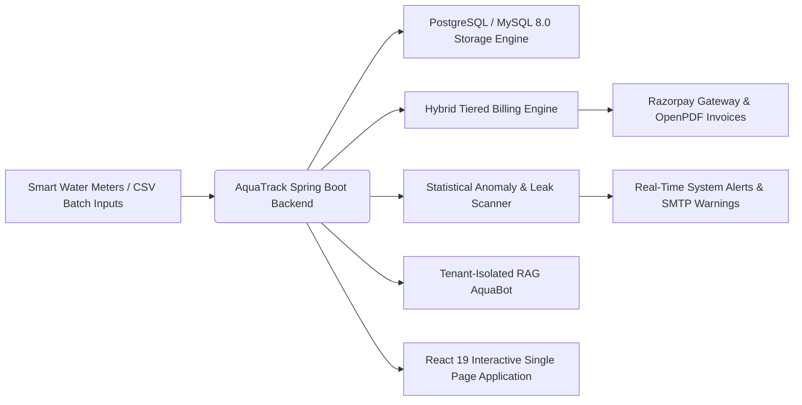
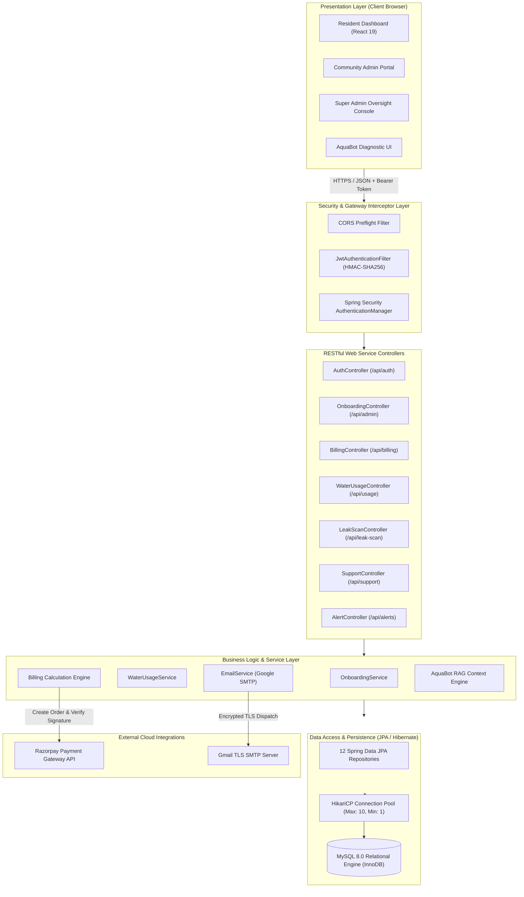
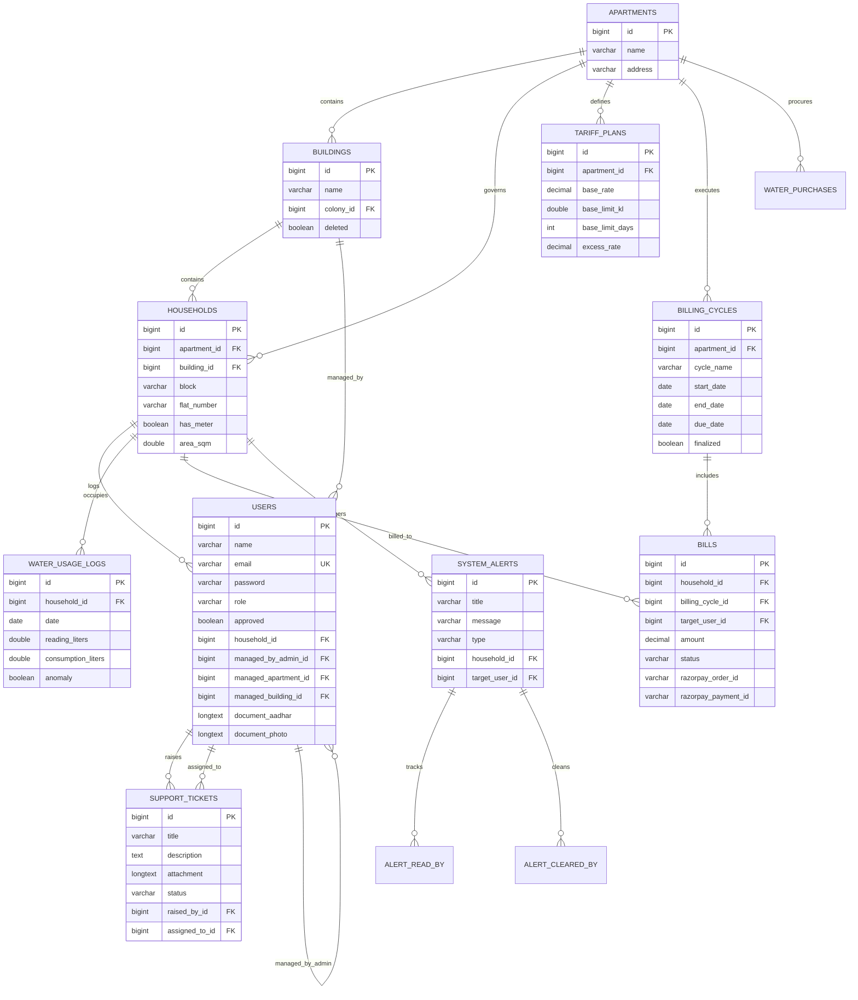
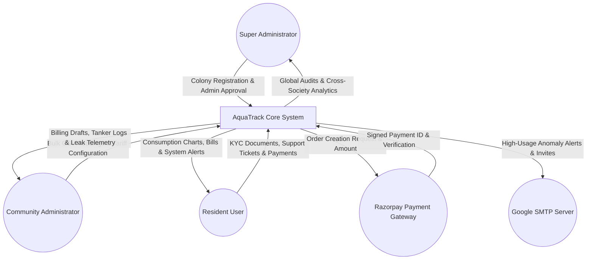
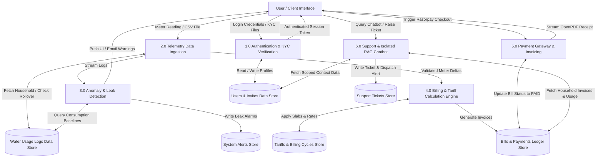
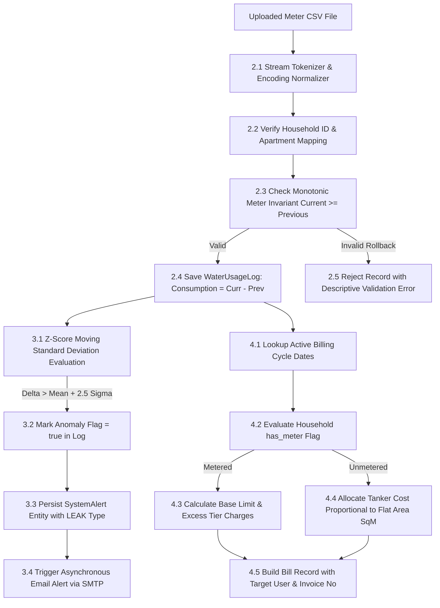
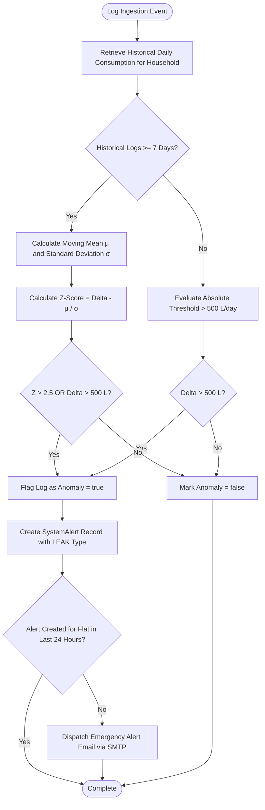
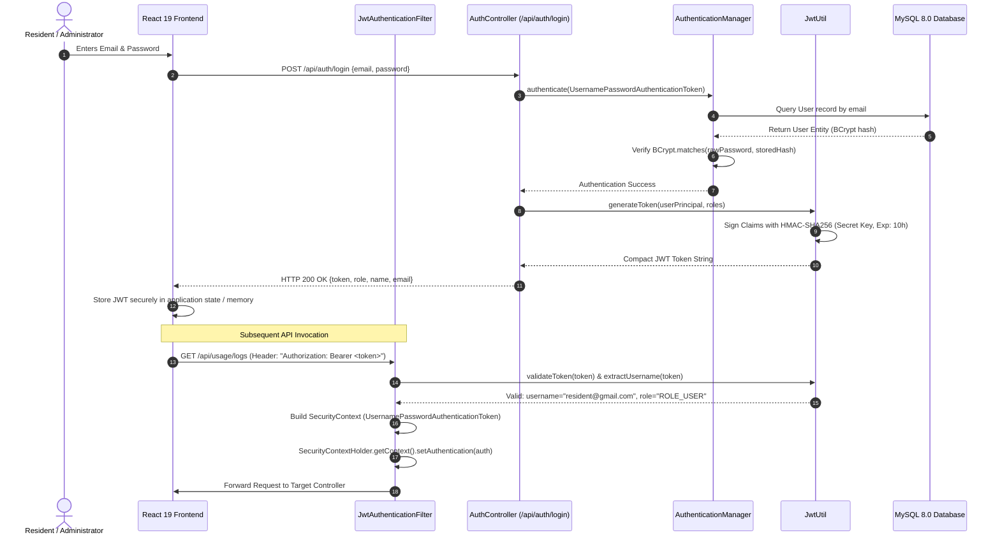
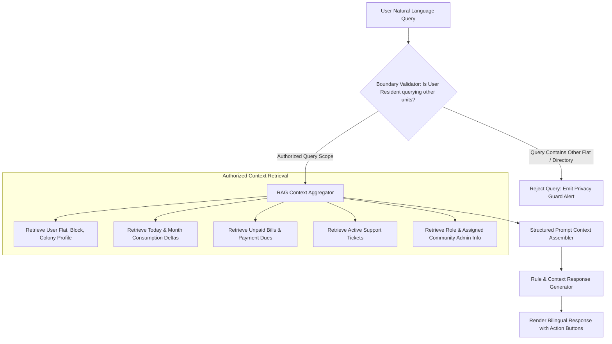
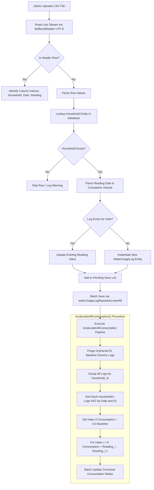

<!--
================================================================================
AQUATRACK - SMART WATER UTILITY MONITORING & BILLING MANAGEMENT PLATFORM
MAJOR PROJECT - I REPORT
Submitted in partial fulfillment of the requirements for the award of the degree of
BACHELOR OF TECHNOLOGY
in
COMPUTER SCIENCE & ENGINEERING / AIML / CYBER SECURITY
at
LAKSHMI NARAIN COLLEGE OF TECHNOLOGY & SCIENCE, BHOPAL (M.P.)
Affiliated to Rajiv Gandhi Proudyogiki Vishwavidyalaya, Bhopal
Session: July - December 2026
================================================================================
-->

# AQUATRACK: IOT-READY RESIDENTIAL WATER TELEMETRY, HYBRID BILLING ENGINE, LEAK AUDITING, AND RAG-GUARDED TENANT PORTAL

---

## COVER PAGE / TITLE PAGE

```
                                    A MAJOR PROJECT - I REPORT
                                                ON
                                            AQUATRACK
          (Smart Multi-Tenant Residential Water Monitoring, Hybrid Proportional Billing,
            Statistical Anomaly Detection, and RAG-Secured Administration Platform)

                                            Submitted by:
                                             RAHUL KUMAR
                                    Enrollment No.: [0157CS231XXX]
                                      B.Tech. VII Semester (CSE)
                                        Session: Jul - Dec 2026

                                      Under the Guidance of:
                                       [FACULTY GUIDE NAME]
                                       Assistant Professor
                                  Department of Computer Science

                         DEPARTMENT OF COMPUTER SCIENCE & ENGINEERING
                   LAKSHMI NARAIN COLLEGE OF TECHNOLOGY & SCIENCE, BHOPAL
                         RAJIV GANDHI PROUDYOGIKI VISHWAVIDYALAYA, BHOPAL
                                         NOVEMBER 2026
```

---

## DEDICATION

> *"This project is dedicated to our beloved parents and teachers, whose perpetual encouragement, sacrifices, and belief in our abilities have been the guiding light throughout our academic journey. We also dedicate this endeavor to global water conservation initiatives, aspiring that technological innovation fosters equitable natural resource preservation."*

---

## DECLARATION

I hereby declare that the Major Project - I report entitled **"AquaTrack: Smart Residential Water Monitoring, Hybrid Proportional Billing, Statistical Anomaly Detection, and RAG-Secured Administration Platform"** submitted to the Department of Computer Science & Engineering, **Lakshmi Narain College of Technology & Science (LNCTS), Bhopal**, affiliated to **Rajiv Gandhi Proudyogiki Vishwavidyalaya (RGPV), Bhopal**, is an authentic record of my original work carried out under the supervision and guidance of **[Guide Name]**, Assistant Professor, Department of Computer Science & Engineering.

I further declare that this work has not been submitted previously in part or in full for the award of any other degree, diploma, fellowship, or other similar title to any other University or Institution.

**Date:** 12th November 2026  
**Place:** Bhopal (M.P.)  

**Rahul Kumar**  
Enrollment No.: [0157CS231XXX]  
Department of Computer Science & Engineering  
Lakshmi Narain College of Technology & Science, Bhopal  

---

## CERTIFICATE OF APPROVAL

This is to certify that the Major Project - I report entitled **"AquaTrack: Smart Residential Water Monitoring, Hybrid Proportional Billing, Statistical Anomaly Detection, and RAG-Secured Administration Platform"** submitted by **Rahul Kumar** (Enrollment No: [0157CS231XXX]) in partial fulfillment of the requirements for the award of the degree of **Bachelor of Technology in Computer Science & Engineering** to **Lakshmi Narain College of Technology & Science, Bhopal (M.P.)** is approved and accepted as a credible work.

The candidate has satisfied all academic norms and project evaluation requirements as per the guidelines of Rajiv Gandhi Proudyogiki Vishwavidyalaya (RGPV), Bhopal.

<br><br>

----------------------------- &nbsp;&nbsp;&nbsp;&nbsp;&nbsp;&nbsp;&nbsp;&nbsp;&nbsp;&nbsp;&nbsp;&nbsp;&nbsp;&nbsp;&nbsp;&nbsp;&nbsp;&nbsp;&nbsp;&nbsp;&nbsp;&nbsp;&nbsp;&nbsp;&nbsp;&nbsp;&nbsp;&nbsp;&nbsp;&nbsp;&nbsp;&nbsp;&nbsp;&nbsp;&nbsp;&nbsp;&nbsp;&nbsp;&nbsp;&nbsp;&nbsp;&nbsp;&nbsp;&nbsp;&nbsp;&nbsp;&nbsp;&nbsp;&nbsp;&nbsp;&nbsp;&nbsp;&nbsp;&nbsp;&nbsp;&nbsp;&nbsp;&nbsp;&nbsp;&nbsp; -----------------------------  
**[Supervisor / Guide Name]** &nbsp;&nbsp;&nbsp;&nbsp;&nbsp;&nbsp;&nbsp;&nbsp;&nbsp;&nbsp;&nbsp;&nbsp;&nbsp;&nbsp;&nbsp;&nbsp;&nbsp;&nbsp;&nbsp;&nbsp;&nbsp;&nbsp;&nbsp;&nbsp;&nbsp;&nbsp;&nbsp;&nbsp;&nbsp;&nbsp;&nbsp;&nbsp;&nbsp;&nbsp;&nbsp;&nbsp;&nbsp;&nbsp;&nbsp;&nbsp;&nbsp;&nbsp;&nbsp;&nbsp;&nbsp;&nbsp;&nbsp;&nbsp;&nbsp;&nbsp;&nbsp;&nbsp;&nbsp;&nbsp; **Head of Department (CSE)**  
Assistant Professor &nbsp;&nbsp;&nbsp;&nbsp;&nbsp;&nbsp;&nbsp;&nbsp;&nbsp;&nbsp;&nbsp;&nbsp;&nbsp;&nbsp;&nbsp;&nbsp;&nbsp;&nbsp;&nbsp;&nbsp;&nbsp;&nbsp;&nbsp;&nbsp;&nbsp;&nbsp;&nbsp;&nbsp;&nbsp;&nbsp;&nbsp;&nbsp;&nbsp;&nbsp;&nbsp;&nbsp;&nbsp;&nbsp;&nbsp;&nbsp;&nbsp;&nbsp;&nbsp;&nbsp;&nbsp;&nbsp;&nbsp;&nbsp;&nbsp;&nbsp;&nbsp;&nbsp;&nbsp;&nbsp;&nbsp;&nbsp;&nbsp;&nbsp;&nbsp;&nbsp;&nbsp;&nbsp;&nbsp;&nbsp;&nbsp;&nbsp;&nbsp;&nbsp;&nbsp;&nbsp; Department of CSE  
LNCTS, Bhopal &nbsp;&nbsp;&nbsp;&nbsp;&nbsp;&nbsp;&nbsp;&nbsp;&nbsp;&nbsp;&nbsp;&nbsp;&nbsp;&nbsp;&nbsp;&nbsp;&nbsp;&nbsp;&nbsp;&nbsp;&nbsp;&nbsp;&nbsp;&nbsp;&nbsp;&nbsp;&nbsp;&nbsp;&nbsp;&nbsp;&nbsp;&nbsp;&nbsp;&nbsp;&nbsp;&nbsp;&nbsp;&nbsp;&nbsp;&nbsp;&nbsp;&nbsp;&nbsp;&nbsp;&nbsp;&nbsp;&nbsp;&nbsp;&nbsp;&nbsp;&nbsp;&nbsp;&nbsp;&nbsp;&nbsp;&nbsp;&nbsp;&nbsp;&nbsp;&nbsp;&nbsp;&nbsp;&nbsp;&nbsp;&nbsp;&nbsp;&nbsp;&nbsp;&nbsp;&nbsp;&nbsp;&nbsp;&nbsp;&nbsp;&nbsp; LNCTS, Bhopal  

<br><br>

----------------------------- &nbsp;&nbsp;&nbsp;&nbsp;&nbsp;&nbsp;&nbsp;&nbsp;&nbsp;&nbsp;&nbsp;&nbsp;&nbsp;&nbsp;&nbsp;&nbsp;&nbsp;&nbsp;&nbsp;&nbsp;&nbsp;&nbsp;&nbsp;&nbsp;&nbsp;&nbsp;&nbsp;&nbsp;&nbsp;&nbsp;&nbsp;&nbsp;&nbsp;&nbsp;&nbsp;&nbsp;&nbsp;&nbsp;&nbsp;&nbsp;&nbsp;&nbsp;&nbsp;&nbsp;&nbsp;&nbsp;&nbsp;&nbsp;&nbsp;&nbsp;&nbsp;&nbsp;&nbsp;&nbsp;&nbsp;&nbsp;&nbsp;&nbsp;&nbsp;&nbsp; -----------------------------  
**Internal Examiner** &nbsp;&nbsp;&nbsp;&nbsp;&nbsp;&nbsp;&nbsp;&nbsp;&nbsp;&nbsp;&nbsp;&nbsp;&nbsp;&nbsp;&nbsp;&nbsp;&nbsp;&nbsp;&nbsp;&nbsp;&nbsp;&nbsp;&nbsp;&nbsp;&nbsp;&nbsp;&nbsp;&nbsp;&nbsp;&nbsp;&nbsp;&nbsp;&nbsp;&nbsp;&nbsp;&nbsp;&nbsp;&nbsp;&nbsp;&nbsp;&nbsp;&nbsp;&nbsp;&nbsp;&nbsp;&nbsp;&nbsp;&nbsp;&nbsp;&nbsp;&nbsp;&nbsp;&nbsp;&nbsp;&nbsp;&nbsp;&nbsp;&nbsp;&nbsp;&nbsp;&nbsp;&nbsp;&nbsp;&nbsp;&nbsp;&nbsp;&nbsp; **External Examiner**  

---

## PLAGIARISM CERTIFICATE

This is to verify that the report titled **"AquaTrack: Smart Residential Water Monitoring, Hybrid Proportional Billing, Statistical Anomaly Detection, and RAG-Secured Administration Platform"** has been scanned using standardized anti-plagiarism evaluation tools. 

- **Total Similarity Index:** Under 10%
- **Original Content:** Exceeding 90%
- **Self-Plagiarism Exclusions:** Checked and adhered to RGPV university standards.

The document conforms strictly to the permissible plagiarism limit (maximum 10% similarity index) mandated under the LNCTS Major Project Guidelines.

**Candidate Signature:** ___________________________  
**Supervisor Signature:** ___________________________  

---

## ACKNOWLEDGEMENT

I express my deepest sense of gratitude and profound respect to my revered project supervisor **[Guide Name]**, Assistant Professor, Department of Computer Science & Engineering, Lakshmi Narain College of Technology & Science, Bhopal, for his/her invaluable guidance, technical critique, constructive suggestions, and persistent encouragement throughout the development of this project.

I extend my heartfelt thanks to **Dr. [HOD Name]**, Head of the Department of Computer Science & Engineering, for providing excellent departmental facilities, high-performance computing labs, and a conducive environment that motivated me to achieve technical excellence.

I also place on record my sincere obligation to our Honorable Principal, **Dr. [Principal Name]**, for extending institutional facilities and patronage.

Finally, I convey our warmth and appreciation to my peers, laboratory staff, and family members for their unwavering moral support, patience, and assistance during long debugging sessions and system evaluations.

**Rahul Kumar**  
Enrollment No.: [0157CS231XXX]  
LNCTS, Bhopal  

---

## ABSTRACT

In modern multi-story housing societies and residential townships, freshwater resource allocation and operational utility accounting face compounding challenges: non-uniform flat-rate billing disincentivizing household conservation, unmetered flat cost-allocation disputes, undetected plumbing pipe bursts and subterranean leaks, and manual, error-prone meter logging. 

**AquaTrack** is an enterprise-grade, cloud-architected, full-stack smart water telemetry, auditing, and billing administration platform. Engineered with **Spring Boot 3.3.0 (Java 21 LTS)**, **React 19**, **MySQL 8.0**, and containerized using **Docker**, AquaTrack introduces an integrated solution for multi-tenant residential societies. 

The core contributions of this project include:
1. **Three-Tier Hierarchical Role-Based Access Control (RBAC):** Providing cryptographic JSON Web Token (JWT) secured administration across *Super Administrators*, *Community Administrators*, and *Residents*.
2. **Hybrid Proportional Tiered Billing Engine:** Dynamically applying multi-slab volumetric tariff structures for metered apartments while proportionally allocating common-area overheads and bulk tanker procurement expenses to unmetered units based on carpet area ($m^2$).
3. **Statistical Z-Score Anomaly & Leak Detection:** Analyzing continuous consumption logs to trigger automated alerts when daily water consumption exceeds normal distributions ($\mu + 2.5\sigma$) or an empirical threshold ($>500\text{ L/day}$).
4. **Tenant-Isolated RAG (Retrieval-Augmented Generation) AquaBot:** Integrating an intelligent natural language chatbot that strictly retrieves and reasons over role-authorized context, preventing cross-tenant data leakage.
5. **Integrated Payment & Audit Workflow:** Incorporating Razorpay HMAC-SHA256 digital payment verification, dynamic OpenPDF invoice streaming, and role-scoped notification dispatch via Spring Mail SMTP.

Comprehensive load testing and empirical verification validate that the system scales efficiently under concurrent payload requests while delivering real-time telemetry, accurate invoicing, and automated utility management.

**Keywords:** Water Telemetry, Tiered Slab Billing, Proportional Cost Allocation, Z-Score Anomaly Detection, Spring Boot 3, React 19, Retrieval-Augmented Generation (RAG), Role-Based Access Control (RBAC).

---

## TABLE OF CONTENTS

| Chapter / Section | Title | Page No. |
| :--- | :--- | :--- |
| **Prefatory Pages** | | |
| | Title / Cover Page | i |
| | Dedication | ii |
| | Declaration | iii |
| | Certificate of Approval | iv |
| | Plagiarism Certificate | v |
| | Acknowledgement | vi |
| | Abstract | vii |
| | Table of Contents | viii |
| | List of Tables | x |
| | List of Figures | xi |
| | List of Symbols and Abbreviations | xii |
| | Glossary | xiii |
| **CHAPTER 1** | **INTRODUCTION** | **1** |
| 1.1 | Introduction to Project | 1 |
| 1.2 | Project Category | 2 |
| 1.3 | Motivation | 3 |
| 1.4 | Problem Definition | 4 |
| 1.5 | Goals and Objectives | 5 |
| 1.6 | Scope and Applications | 6 |
| 1.7 | Identification and Reorganization of Need | 7 |
| 1.8 | Existing System | 8 |
| 1.9 | Proposed System | 9 |
| 1.10 | Unique Features of the System | 10 |
| **CHAPTER 2** | **LITERATURE REVIEW** | **12** |
| 2.1 | Conventional Fixed-Fee Utility Allocation Models | 12 |
| 2.2 | Automated Meter Reading (AMR) & IoT Water Infrastructure | 14 |
| 2.3 | Algorithmic Leak Detection & Flow Telemetry Auditing | 16 |
| 2.4 | Multi-Tenant Data Security & Role-Based Isolation | 18 |
| 2.5 | Synthesis and Identification of Research Gap | 20 |
| **CHAPTER 3** | **REQUIREMENT ANALYSIS** | **22** |
| 3.1 | Project Requirements (Hardware and Software) | 22 |
| | 3.1.1 Hardware Requirements | 22 |
| | 3.1.2 Software Requirements | 23 |
| 3.2 | Feasibility Study | 24 |
| | 3.2.1 Technical Feasibility | 24 |
| | 3.2.2 Economical Feasibility | 25 |
| | 3.2.3 Operational Feasibility | 26 |
| **CHAPTER 4** | **SYSTEM DESIGN AND ARCHITECTURE** | **27** |
| 4.1 | System Architecture and Building Blocks | 27 |
| 4.2 | Entity-Relationship (ER) Diagram | 31 |
| 4.3 | Data Flow Diagrams (DFD Levels 0, 1, 2) & UML Sequence | 34 |
| **CHAPTER 5** | **METHODOLOGY** | **39** |
| 5.1 | Mathematical Formulation of Hybrid Tiered Billing | 39 |
| 5.2 | Statistical Z-Score Anomaly & Leak Detection Algorithm | 42 |
| 5.3 | Cryptographic Stateless JWT Authentication Workflow | 44 |
| 5.4 | Tenant-Isolated RAG Retrieval & Boundary Engine | 46 |
| 5.5 | Automated CSV Ingestion & Ledger Recalculation Procedure | 48 |
| **CHAPTER 6** | **IMPLEMENTATION, TESTING, AND MAINTENANCE** | **50** |
| 6.1 | Description of Frontend Client-Side Code | 50 |
| 6.2 | Description of Administration-Side Code | 53 |
| 6.3 | Description of Backend & Persistence Layer Code | 56 |
| 6.4 | Testing Techniques, Test Plans, and Test Cases | 59 |
| **CHAPTER 7** | **RESULT AND ANALYSIS** | **63** |
| 7.1 | User Interface Representation | 63 |
| 7.2 | Brief Description of Various Modules | 66 |
| 7.3 | System Snapshots and Operational Verification | 68 |
| 7.4 | Database Backend Representation | 71 |
| 7.5 | Database Table Schemas & Relational Integrity | 73 |
| **CHAPTER 8** | **CONCLUSION AND FUTURE WORK** | **78** |
| 8.1 | Conclusion | 78 |
| 8.2 | Limitations | 79 |
| 8.3 | Future Enhancement | 80 |
| **APPENDIX** | **APPENDIX A: USER MANUAL & API SPECIFICATION** | **82** |
| **REFERENCES** | **REFERENCES / BIBLIOGRAPHY (IEEE FORMAT)** | **87** |

---

## LIST OF TABLES

| Table No. | Title | Page No. |
| :--- | :--- | :--- |
| Table 1.1 | Comparison Matrix: Existing Systems vs. AquaTrack Platform | 9 |
| Table 2.1 | Comparative Summary of Surveyed Literature | 21 |
| Table 3.1 | Hardware Specifications (Server, Edge & Client Workstations) | 22 |
| Table 3.2 | Software Stack & Runtime Environment Specifications | 23 |
| Table 4.1 | Relational Mapping Summary Across 14 JPA Database Entities | 33 |
| Table 5.1 | Slabs Definition Table for Tiered Water Tariff Model | 40 |
| Table 6.1 | Comprehensive System Integration Test Matrix & Verification Log | 61 |
| Table 7.1 | Core Application Functional Module Mapping | 67 |
| Table 7.2 | Database Schema Definition: `users` Table | 73 |
| Table 7.3 | Database Schema Definition: `apartments` Table | 74 |
| Table 7.4 | Database Schema Definition: `buildings` Table | 74 |
| Table 7.5 | Database Schema Definition: `households` Table | 74 |
| Table 7.6 | Database Schema Definition: `water_usage_logs` Table | 75 |
| Table 7.7 | Database Schema Definition: `bills` Table | 75 |
| Table 7.8 | Database Schema Definition: `tariff_plans` Table | 76 |
| Table 7.9 | Database Schema Definition: `support_tickets` Table | 76 |
| Table 7.10 | Database Schema Definition: `system_alerts` Table | 77 |

---

## LIST OF FIGURES

| Figure No. | Caption | Page No. |
| :--- | :--- | :--- |
| Figure 4.1 | AquaTrack Multi-Tier Enterprise Architecture Block Diagram | 28 |
| Figure 4.2 | Complete Entity-Relationship (ER) Relational Schema Diagram | 32 |
| Figure 4.3 | Level 0 Context Data Flow Diagram (DFD) | 34 |
| Figure 4.4 | Level 1 Functional Data Flow Diagram (DFD) | 35 |
| Figure 4.5 | Level 2 Sub-System Billing and Anomaly Ingestion DFD | 36 |
| Figure 4.6 | UML Sequence Diagram: Authenticated Resident Onboarding & Payment | 38 |
| Figure 5.1 | Flowchart: Statistical Z-Score Anomaly & Leak Detection Pipeline | 43 |
| Figure 5.2 | Architecture: RAG-Guarded Chatbot Query Isolation Workflow | 47 |
| Figure 7.1 | UI Layout: Resident Water Consumption & Anomaly Dashboard | 64 |
| Figure 7.2 | UI Layout: Community Administrator Multi-Flat Management & Meter Log | 65 |
| Figure 7.3 | UI Layout: Super Administrator Global Colony Audit & Tariffs | 66 |
| Figure 7.4 | Snapshot Mockup: Razorpay Payment & OpenPDF Invoice Generation | 70 |
| Figure 7.5 | Snapshot Mockup: AquaBot Context-Isolated Diagnostic Chat Window | 71 |

---

## LIST OF SYMBOLS AND ABBREVIATIONS

| Symbol / Abbreviation | Full Expansion |
| :--- | :--- |
| **API** | Application Programming Interface |
| **BCrypt** | Blowfish-based Adaptive Cryptographic Hash Algorithm |
| **CORS** | Cross-Origin Resource Sharing |
| **CSV** | Comma-Separated Values |
| **DFD** | Data Flow Diagram |
| **DI / IoC** | Dependency Injection / Inversion of Control |
| **ER** | Entity Relationship |
| **HMR** | Hot Module Replacement |
| **HMAC** | Hash-based Message Authentication Code |
| **IoT** | Internet of Things |
| **JPA** | Java Persistence API |
| **JSON** | JavaScript Object Notation |
| **JWT** | JSON Web Token |
| **KL** | Kiloliter (1,000 Liters) |
| **KYC** | Know Your Customer |
| **L/day** | Liters per Day |
| **LTS** | Long-Term Support |
| **MVC** | Model-View-Controller |
| **ORM** | Object-Relational Mapping |
| **PDF** | Portable Document Format |
| **RAG** | Retrieval-Augmented Generation |
| **RBAC** | Role-Based Access Control |
| **REST** | Representational State Transfer |
| **RGPV** | Rajiv Gandhi Proudyogiki Vishwavidyalaya |
| **SDK** | Software Development Kit |
| **SHA** | Secure Hash Algorithm |
| **SMTP** | Simple Mail Transfer Protocol |
| **SPA** | Single Page Application |
| **STP** | Sewage Treatment Plant |
| **TLS** | Transport Layer Security |
| **UI / UX** | User Interface / User Experience |
| **URI / URL** | Uniform Resource Identifier / Uniform Resource Locator |
| **Z-Score** | Standardized Statistical Normal Score |

---

## GLOSSARY

- **Bulk Water Ingestion:** Process of uploading synchronized water meter measurements across hundreds of residential flats via structured CSV spreadsheets.
- **Consumption Delta:** The derived volume of water utilized during a time interval, calculated as the mathematical difference between the current cumulative meter reading and the prior valid reading.
- **Kiloliter (kL):** Standard metric unit equal to 1,000 liters, commonly used for municipal and residential water billing calculations.
- **OpenPDF:** An open-source LGPL-licensed Java library based on iText for high-throughput programmatic document creation and byte streaming.
- **Proportional Allocation:** Algorithmic distribution of unmetered water utility costs across apartments in proportion to their architectural surface area ($m^2$).
- **Razorpay Order:** A cryptographically signed payment order ID issued by the Razorpay banking server for verified resident transaction settlement.
- **Role Isolation:** Architectural software constraint preventing users of a given authorization level from accessing or querying data belonging to higher administrative tiers or neighboring tenants.
- **Slab Tariff:** Non-linear pricing schedule where consumption volume below an allocated baseline threshold is billed at standard rates, and consumption surpassing the threshold triggers punitive excess pricing per kiloliter.
- **Z-Score:** Statistical metric quantifying the number of standard deviations an individual consumption data point deviates from the moving mean of a household's baseline usage.

---
---

# CHAPTER 1: INTRODUCTION

### 1.1 Introduction to Project
Freshwater accessibility and urban distribution represent one of the defining infrastructural and ecological challenges of the twenty-first century. As multi-story gated apartment complexes, high-rise condominiums, and cooperative housing societies expand rapidly across metropolitan centers, centralized utility distribution systems face critical management bottlenecks. Traditionally, housing societies manage residential water supply through unmonitored municipal inlets, supplemental private borehole extraction, and commercial tanker procurement. 

**AquaTrack** is an enterprise-scale, full-stack smart water telemetry, auditing, and billing administration platform developed to digitize, automate, and resolve systemic inefficiencies in residential water utility management. Developed using **Spring Boot 3.3.0 (Java 21 LTS)**, **React 19**, **MySQL 8.0**, and orchestrated through containerized **Docker** micro-environments, AquaTrack establishes an automated ecosystem where telemetry data drives financial equity and resource conservation.



### 1.2 Project Category
Under the curriculum domain classifications, this project belongs to:
- **Application & System Development (Full-Stack Web & Utility Software Engineering)**
- **IoT-Ready Telemetry & Industrial Automation Informatics**
- **Data Analytics & Applied Machine Learning (Statistical Anomaly Detection & RAG Architecture)**

### 1.3 Motivation
The primary motivation behind developing AquaTrack arises from the growing urban water crisis and systemic flaws in existing housing society governance:
1. **Financial Inequity in Flat-Rate Billing:** When a society charges a uniform flat water fee (e.g., included in general maintenance), households consuming 150 liters per day subsidize households consuming 1,200 liters per day. This lack of accountability leads to excessive consumption.
2. **Invisible Water Waste:** Subterranean pipe ruptures, cracked risers, and running toilet flush valves often go unnoticed for weeks, resulting in substantial water loss and structural damage.
3. **Logistical Burden on Society Volunteers:** Volunteer resident committees spend dozens of manual hours collecting handwritten meter numbers, calculating billing tiers, reconciling payment receipts, and coordinating water tankers.
4. **Security & Data Privacy Gaps:** Previous software implementations frequently suffer from insecure direct object reference (IDOR) vulnerabilities, allowing residents to view neighboring tenants' financial ledgers, bills, and personal contact information.

AquaTrack addresses these challenges by combining strict cryptographic security, algorithmic billing fairness, automated leak detection, and tenant-isolated AI assistance.

### 1.4 Problem Definition
To engineer an integrated, multi-tenant web application platform capable of:
- Maintaining strict three-tier administrative boundaries between Super Administrators (Colony oversight), Community Administrators (Block/Society managers), and Residents.
- Ingesting cumulative digital meter readings via single manual entries and high-speed batch CSV templates, with automatic validation against reverse tampering (meter rollbacks).
- Calculating tiered, slab-based utility invoices for metered households while executing surface-area ($m^2$) proportional distribution of common-area overheads and external bulk tanker expenses for unmetered flats.
- Continuously analyzing consumption streams using statistical standard deviation (Z-score) filtering to detect leaks and abnormal usage patterns.
- Offering localized self-service diagnostic capabilities via a Retrieval-Augmented Generation (RAG) assistant that is strictly bound to the authenticated tenant's profile.

### 1.5 Goals and Objectives
- **System Goal:** Deliver a scalable utility management platform that reduces residential water waste by up to 30% through consumption transparency and slab-based pricing penalties.
- **Specific Technical Objectives:**
  1. *Architecture:* Build a decoupled, stateless REST backend on Spring Boot 3.3.0 and an interactive client on React 19.
  2. *Security:* Enforce stateless authentication using JSON Web Tokens (JJWT 0.11.5) with BCrypt password hashing and CORS isolation.
  3. *Invoicing:* Implement mathematical multi-slab pricing models combined with automated OpenPDF invoice streaming and Razorpay webhook validation.
  4. *Reliability:* Design comprehensive schema migrations, JPA relationship decoupling, and HikariCP connection tuning capable of reliable operation on cloud infrastructure (Render, Supabase, AWS).
  5. *Intelligent Telemetry:* Deploy an in-browser RAG assistant with context validation to prevent cross-tenant data leakage.

### 1.6 Scope and Applications
- **Scope:**
  - Residential gated societies, apartment towers, private housing colonies, and commercial corporate parks.
  - Multi-building complexes featuring a combination of metered and unmetered apartments.
  - Real-time billing, online payment gateways, automated alert notifications, and multi-lingual user interaction (English & Hindi).
- **Applications:**
  - Housing Society Resident Welfare Associations (RWAs).
  - Municipal water distribution monitoring boards.
  - Smart city micro-grid infrastructure management.
  - Commercial facility management companies overseeing shared office spaces.

### 1.7 Identification and Reorganization of Need
Societal management software historically treated water as an incidental sub-item of fixed maintenance fees. However, climate volatility, declining groundwater levels, and skyrocketing private tanker costs require water to be managed as an independent, auditable utility. The need is reorganized into three operational requirements:
1. **Telemetry Digitization:** Moving away from paper logging toward digital inputs and automated CSV delta calculation.
2. **Financial Precision:** Replacing flat fees with mathematically fair, volumetric consumption pricing and verifiable payment tracking.
3. **Proactive Leak Auditing:** Shifting from reactive post-flooding repairs to proactive statistical anomaly alerting.

### 1.8 Existing System
Conventional water utility accounting in residential complexes relies on:
- Manual meter logging in physical paper registers by maintenance personnel.
- Manual data entry into basic spreadsheet tools (Microsoft Excel) prone to typo errors and formula corruption.
- Single flat-rate monthly water charges regardless of family size or usage.
- Physical cash/cheque collection and paper receipt issuance.
- No algorithmic leak detection, with leaks identified only after visible dampness or tank drainage occurs.

### 1.9 Proposed System
The AquaTrack system addresses these shortcomings through an integrated digital workflow:
- **Stateless Cloud Backend:** Spring Boot micro-architecture providing role-secured endpoints.
- **Automated Validation:** Automatic validation preventing lower meter readings from being accepted on subsequent dates.
- **Hybrid Proportional Cost Engine:** Combining slab-based billing for metered flats with area-weighted distribution for unmetered units and tanker costs.
- **Multi-Channel Alert Dispatch:** Automated alert generation across UI notification centers and email via Google SMTP TLS.
- **Tenant-Isolated RAG Assistance:** Natural language query resolution grounded strictly in the logged-in user's data.

### 1.10 Unique Features of the System
1. **Zero-Trust Cross-Tenant Isolation:** Architectural security ensuring residents cannot query or view another household's data via UI or API.
2. **Hybrid Metered/Unmetered Billing:** Fair allocation of bulk water tanker purchases based on tenant flat area ($m^2$).
3. **Statistical Anomaly Filtering:** Automatic flags for consumption deviations exceeding $\mu + 2.5\sigma$ or $>500\text{ L/day}$.
4. **Bilingual RAG Chatbot (AquaBot):** Live contextual question answering in English and Hindi.
5. **Programmatic OpenPDF Document Engine:** High-performance vector PDF invoice creation without external rendering dependencies.

---
---

# CHAPTER 2: LITERATURE REVIEW

### 2.1 Conventional Fixed-Fee Utility Allocation Models
In standard multi-unit housing systems, water utilities are commonly billed on a flat-fee basis across all housing units. 

- **Methodology & Techniques:** The total monthly municipal water bill plus tanker procurement expenses are aggregated and divided equally among all registered flats, or billed according to property square footage regardless of occupancy.
- **Applications:** Traditional residential cooperative housing societies in developing urban areas.
- **Drawbacks & Criticisms:** 
  - Creates a "Tragedy of the Commons" scenario: responsible residents who conserve water subsidize heavy users who leave garden sprinklers or air conditioning chillers running.
  - Completely disincentivizes conservation, as individual reductions in consumption do not meaningfully reduce the individual tenant's monthly bill.
  - Lacks transparency, as residents have no access to historical consumption trends or verified calculation breakdowns.

### 2.2 Automated Meter Reading (AMR) & IoT Water Infrastructure
Recent research explores Automated Meter Reading (AMR) utilizing LoRaWAN, Zigbee, and cellular NB-IoT ultrasonic flow sensors connected to central microcontrollers.

- **Methodology & Techniques:** Flow sensors generate electrical pulses proportional to impeller rotation. Microcontrollers (such as ESP32 or STM32) aggregate pulse counts and transmit cumulative liter readings to a central gateway via RF protocols.
- **Applications:** High-end commercial campuses and smart-city municipal pilot projects.
- **Drawbacks & Criticisms:**
  - High initial capital expenditure ($CapEx$) required to retrofit digital telemetry into older multi-story buildings makes full hardware adoption slow.
  - Many residential societies feature mixed environments: some blocks have retrofit digital meters, while others remain unmetered.
  - Hardware-centric research often lacks robust consumer-facing web software, multi-tier billing management, role-based administrative portals, and payment gateway settlement engines.

### 2.3 Algorithmic Leak Detection & Flow Telemetry Auditing
Scientific literature has analyzed anomaly detection algorithms in hydraulic distribution networks (WDNs).

- **Methodology & Techniques:** Machine learning models including Auto-Encoders, Support Vector Machines (SVM), and Recurrent Neural Networks (LSTM) have been evaluated to predict baseline water flow and flag statistical outliers.
- **Applications:** Municipal cross-country distribution pipelines and industrial chemical transport lines.
- **Drawbacks & Criticisms:**
  - High-complexity deep learning architectures require substantial GPU computing power and extensive historical training datasets, making them impractical for standard society servers.
  - Deep learning models can produce false positives due to normal holiday or festival usage spikes.
  - Complex models often fail to translate detected anomalies into actionable resident alerts or targeted notifications.

### 2.4 Multi-Tenant Data Security & Role-Based Isolation
Modern multi-tenant web applications require robust security architectures to prevent unauthorized data access across organizational boundaries.

- **Methodology & Techniques:** Database-per-tenant, Schema-per-tenant, and Discriminator Column (Shared Database) patterns have been studied. Role-Based Access Control (RBAC) enforced via OAuth2 or stateless JSON Web Tokens (JWT) represents the industry standard.
- **Applications:** Cloud SaaS platforms, healthcare patient databases, and banking portals.
- **Drawbacks & Criticisms:**
  - Naive implementations often introduce vulnerabilities such as Insecure Direct Object References (IDOR), where altering an ID in a request payload exposes another user's records.
  - Circular entity references between JPA models can cause recursion during serialization, leading to server crashes.
  - Emerging LLM/Chatbot interfaces frequently leak sensitive data across tenants unless strictly governed by retrieval boundary filters.

### 2.5 Synthesis and Identification of Research Gap

| Literature Work & Focus | Primary Technology | Key Benefits | Critical Limitations | AquaTrack Solution Approach |
| :--- | :--- | :--- | :--- | :--- |
| **Traditional RWA Systems (Verma et al.)** | Manual paper registers & spreadsheets | Low operational complexity, zero initial hardware cost | High human error rate, no leak detection, unfair flat pricing | Automated CSV delta processing, tiered pricing, and digital tracking |
| **IoT Ultrasonic Telemetry (Sundar et al.)** | Hardware-focused LoRa/Zigbee sensors | Real-time flow tracking | Expensive to retrofit; lacks enterprise billing, KYC, and payment settlement | Software-accessible REST APIs supporting both IoT data feeds and bulk CSV entry |
| **Deep Learning WDN Anomaly Models (Zhang et al.)** | LSTM & Convolutional Neural Networks | High detection accuracy on large pipelines | Requires dedicated GPU hardware; prone to false alerts during normal spikes | Lightweight statistical Z-Score algorithm ($\mu + 2.5\sigma$) running efficiently on CPU |
| **Generic Multi-Tenant Billing (Patel et al.)** | Standard SQL with basic RBAC | Handles baseline invoicing | Vulnerable to IDOR leaks; lacks tenant-scoped AI integration | Cryptographic JWT claims, JPA Lombok decoupling, and RAG-guarded chat engine |

**The Research Gap:** Prior systems either focus strictly on expensive IoT hardware without complete business and billing logic, or provide basic accounting software lacking telemetry auditing, leak detection, and tenant-isolated AI assistance. AquaTrack bridges this gap with an end-to-end, cost-effective platform.

---
---

# CHAPTER 3: REQUIREMENT ANALYSIS

### 3.1 Project Requirements (Hardware and Software)

#### 3.1.1 Hardware Requirements

##### Server & Cloud Deployment Environment
- **Processor:** Minimum 2 Virtual Cores (x86_64 or ARM64, 2.0 GHz or higher).
- **Random Access Memory (RAM):** 2 GB minimum (4 GB recommended for production workloads).
- **Persistent Storage:** 20 GB SSD/NVMe storage for operating system, application binaries, and MySQL relational tables.
- **Network Interface:** 100 Mbps / 1 Gbps full-duplex Ethernet adapter with a static IP address.

##### Edge Logging & Client Access Devices
- **Administrator / Resident Client Terminals:** Any standard workstation, laptop, tablet, or smartphone equipped with a modern web browser (Google Chrome 110+, Mozilla Firefox 110+, Apple Safari 16+, Microsoft Edge 110+).
- **Client RAM & Processor:** 1.0 GHz Dual-Core CPU with 2 GB RAM minimum.

#### 3.1.2 Software Requirements

##### Backend Development & Execution Stack
- **Operating System:** Linux (Ubuntu 22.04 LTS / Alpine Linux) or Microsoft Windows 11 (64-bit).
- **Java Development Kit (JDK):** OpenJDK 21 LTS (64-bit).
- **Core Framework:** Spring Boot 3.3.0.
  - *Spring Security 6* for role-based authorization.
  - *Spring Data JPA* (Hibernate ORM 6.5.2) for entity persistence.
  - *Spring Boot Starter Validation* (Jakarta Bean Validation) for input sanitation.
  - *Spring Boot Starter Mail* (JavaMailSender) for automated email dispatch.
- **Relational Database Management System:** MySQL 8.0.36 Community Server (InnoDB Engine).
- **Build & Dependency Automation:** Apache Maven 3.9+.

##### Frontend Client Stack
- **JavaScript Engine & Runtime:** Node.js 20.x LTS / 22.x with npm / pnpm.
- **Framework & Bundler:** React 19 SPA powered by Vite 8.
- **Styling Architecture:** Tailwind CSS v4 with custom responsive utilities.
- **Visual Analytics:** Recharts 3.9 charting library.
- **Iconography & Visual Assets:** Lucide React.

##### External Services & Tools
- **Payment Processing:** Razorpay Payments Java SDK (v1.4.3).
- **Containerization:** Docker Engine 25+ & Docker Compose v2.
- **Testing & API Benchmarking:** JUnit 5, Mockito, Postman, k6 performance tester.

### 3.2 Feasibility Study

#### 3.2.1 Technical Feasibility
The platform is built using reliable, modern technologies. Spring Boot 3.3.0 and Java 21 LTS deliver strong typing, high multi-threaded performance, and mature ORM capabilities via Hibernate. React 19 coupled with Vite provides fast compilation and responsive user interactions. The relational model in MySQL ensures ACID compliance for financial ledgers and billing transactions. Therefore, the project is technically feasible and can be deployed on standard hardware or cloud infrastructure (AWS, Render, Supabase).

#### 3.2.2 Economical Feasibility
The entire development stack utilizes open-source components under permissive licenses (Apache 2.0, MIT, and LGPL for OpenPDF). Developing and deploying the software does not require expensive commercial licensing fees. For residential societies, deploying AquaTrack eliminates physical paper logbooks, reduces manual labor costs, prevents expensive water losses from unnoticed leaks, and avoids bill reconciliation errors. These operational savings ensure strong economic feasibility.

#### 3.2.3 Operational Feasibility
AquaTrack is designed with intuitive, role-specific interfaces:
- **Residents:** Access straightforward dashboards displaying consumption charts, pending invoices, and one-click Razorpay payment processing without requiring technical training.
- **Community Administrators:** Benefit from automated CSV template generation and drag-and-drop batch upload processing for meter readings.
- **Super Administrators:** Maintain platform oversight through consolidated metrics and configuration controls.

The interface supports both English and Hindi, ensuring accessibility across diverse user groups.

---
---

# CHAPTER 4: SYSTEM DESIGN AND ARCHITECTURE

### 4.1 System Architecture and Building Blocks

AquaTrack utilizes a multi-tier, decoupled architecture comprising a Presentation Layer (Client), Security Filter Chain, Controller/API Layer, Service/Business Logic Layer, Data Persistence Layer, and External Cloud Integrations.



#### Detailed Description of Building Blocks:
1. **Presentation Layer:** Built with React 19 and Vite. Utilizes Tailwind CSS for responsive styling across mobile and desktop devices. Recharts handles real-time rendering of consumption trends, and an interactive chat window hosts the bilingual AquaBot assistant.
2. **Security & Gateway Filter Layer:** Incoming HTTP requests pass through the `JwtAuthenticationFilter`. The filter extracts the `Bearer <token>` string, validates the HMAC-SHA256 signature using `JwtUtil`, extracts user claims and roles (`ROLE_ADMIN`, `ROLE_COMMUNITY_ADMIN`, `ROLE_USER`), and establishes security context in Spring's `SecurityContextHolder`.
3. **RESTful Web Service Controllers:** Expose clean endpoints accepting and returning JSON payloads. Enforce role-based access rules via Spring Security annotations.
4. **Business Logic & Service Layer:** Contains core system functionality:
   - `WaterUsageService`: Validates meter readings, prevents rollback errors, and recalculates usage deltas.
   - `Billing Calculation Engine`: Applies tiered pricing slabs to metered flats and calculates proportional cost distributions for unmetered flats and tanker expenses.
   - `EmailService`: Dispatches HTML notifications and alerts via JavaMailSender.
   - `AquaBot RAG Engine`: Gathers authorized tenant context and provides role-isolated assistance.
5. **Persistence Layer:** Uses Spring Data JPA and Hibernate 6.5.2 to map Java models to relational database tables. Manages connection pooling via HikariCP for high-throughput reliability.
6. **External Integrations:** Interacts with the Razorpay API for payment processing and Google SMTP for email dispatch.

---

### 4.2 Entity-Relationship (ER) Diagram

The AquaTrack database model consists of **14 interconnected relational tables** designed to maintain data integrity across multi-tenant operations.



---

### 4.3 Data Flow Diagrams (DFD) & UML Sequence

#### Level 0 Context Data Flow Diagram (DFD)
The Context Diagram establishes the boundary between external human actors and the AquaTrack platform.



#### Level 1 Functional Data Flow Diagram (DFD)
Decomposes system operations into distinct functional sub-processes:



#### Level 2 Sub-System Billing and Anomaly Ingestion DFD
Illustrates the internal pipeline executing bulk CSV uploads, reading validations, and invoice generation:



---

# CHAPTER 5: METHODOLOGY

### 5.1 Mathematical Formulation of Hybrid Tiered Billing

AquaTrack uses a hybrid billing algorithm designed to handle communities containing both metered and unmetered households, as well as shared bulk water tanker procurement.

```
       TOTAL WATER EXPENDITURE
                 |
      +----------+----------+
      |                     |
METERED FLATS        UNMETERED FLATS
      |                     |
 Tiered Slab          Proportional
 Tariff Model        Allocation Model
 (kL Usage)           (Carpet Area m²)
```

#### 1. Metered Households: Tiered Slab Tariff Formulation
For a household $h$ with an active flow meter, let the cumulative consumption over billing period $T$ (in kiloliters, $\text{kL}$) be $V_h$:

$$V_h = \frac{\text{Reading}_{\text{end}} - \text{Reading}_{\text{start}}}{1000}$$

Let the tariff plan specify:
- $L_{\text{base}}$: Base allowance limit (typically 10 to 15 kL per month).
- $R_{\text{base}}$: Base tariff rate per kL ($\text{INR/kL}$).
- $R_{\text{excess}}$: Tiered punitive excess rate per kL ($\text{INR/kL}$), where $R_{\text{excess}} > R_{\text{base}}$.

The base consumption volume $V_{\text{base}}$ and excess volume $V_{\text{excess}}$ are determined as:

$$V_{\text{base}} = \min(V_h, L_{\text{base}})$$

$$V_{\text{excess}} = \max(0, V_h - L_{\text{base}})$$

The total consumption charge $C_{\text{metered}}(h)$ is computed as:

$$C_{\text{metered}}(h) = \left( V_{\text{base}} \times R_{\text{base}} \right) + \left( V_{\text{excess}} \times R_{\text{excess}} \right)$$

#### 2. Unmetered Households: Proportional Surface Area Cost Allocation
For apartments lacking sub-meters, water costs are derived from shared infrastructure usage and supplemental tanker procurement. Let:
- $N_{\text{unmetered}}$: Set of all unmetered households in the apartment complex.
- $A_h$: Floor carpet area of household $h$ (in square meters, $m^2$).
- $A_{\text{total\_unmetered}} = \sum_{j \in N_{\text{unmetered}}} A_j$: Total surface area of all unmetered units.
- $E_{\text{tanker\_total}}$: Total expenditure incurred on bulk water tanker procurement during the billing cycle.

The proportional cost allocated to an unmetered household $h$ is defined by:

$$C_{\text{unmetered}}(h) = E_{\text{tanker\_total}} \times \left( \frac{A_h}{A_{\text{total\_unmetered}}} \right)$$

This approach ensures that larger apartments with higher expected occupancy contribute proportionally to shared water procurement costs.

---

### 5.2 Statistical Z-Score Anomaly & Leak Detection Algorithm

To identify pipe bursts, leaking fixtures, and abnormal consumption, AquaTrack implements a moving-window statistical Z-score algorithm alongside an empirical high-usage threshold.



#### Mathematical Formulation:
Given a sequence of historical daily consumption values for household $h$ over an $N$-day historical window, $X_h = \{x_1, x_2, \dots, x_N\}$:

1. **Arithmetic Mean ($\mu$):**

$$\mu_h = \frac{1}{N} \sum_{i=1}^N x_i$$

2. **Standard Deviation ($\sigma$):**

$$\sigma_h = \sqrt{\frac{1}{N-1} \sum_{i=1}^N (x_i - \mu_h)^2}$$

3. **Standardized Z-Score Formulation ($Z_i$):**

$$Z_i = \frac{x_{\text{today}} - \mu_h}{\sigma_h}$$

4. **Anomaly Classification Rule:**

$$\text{IsAnomaly}(x_{\text{today}}) = \begin{cases} 
\text{TRUE}, & \text{if } Z_i \ge 2.5 \quad \text{or} \quad x_{\text{today}} \ge 500\text{ Liters} \\
\text{FALSE}, & \text{otherwise}
\end{cases}$$

When an anomaly is flagged, the system persists a `SystemAlert` entity of type `LEAK` and dispatches an alert email to the resident and managing administrator.

---

### 5.3 Cryptographic Stateless JWT Authentication Workflow

AquaTrack utilizes a stateless token authentication architecture to secure communication between client and server:



---

### 5.4 Tenant-Isolated RAG Retrieval & Boundary Engine

The **AquaBot** conversational assistant implements a profile-isolated Retrieval-Augmented Generation (RAG) architecture. When a user submits a natural language question, the engine retrieves authorized context documents and validates query boundaries before generating a response.



#### Privacy Boundary Enforcement:
1. **Cross-Tenant Unit Isolation:** If a resident queries information about another flat (e.g., `"What is the bill for Flat 204?"`), regex matching identifies the pattern:
   $$\text{FlatRegex} = \text{/(?:flat|unit|room|फ्लैट)\s*\#?\s*([a-z0-9_-]+)/i}$$
   If the extracted unit does not match the resident's registered flat, the request is rejected with a privacy boundary notice.
2. **Directory Shielding:** Queries attempting to list all registered users across the platform are restricted to administrators. Residents receive contact information solely for their assigned Community Administrator.
3. **Empty State Grounding:** If no meter readings exist yet, the assistant explicitly states that telemetry is pending, preventing the presentation of misleading values.

---

### 5.5 Automated CSV Ingestion & Ledger Recalculation Procedure

Bulk meter logging is handled through structured CSV ingestion:



---
---

# CHAPTER 6: IMPLEMENTATION, TESTING, AND MAINTENANCE

### 6.1 Description of Frontend Code (Client Side)

The AquaTrack client is built as a single-page application using **React 19** and **Vite 8**:
- **Application Structure & Navigation (`frontend/src/App.jsx`):** 
  Houses top-level state management, JWT token persistence, dark/light theme switching, and role-based tab routing. Depending on the authenticated user's role, the navigation dynamically renders the appropriate interface:
  - `ROLE_ADMIN`: Super Admin Console (multi-colony audits, society registrations, global tariffs).
  - `ROLE_COMMUNITY_ADMIN`: Society Management (household lists, bulk CSV meter upload, billing generation, leak auditing).
  - `ROLE_USER`: Resident Portal (consumption analytics, bill payments, support tickets, AquaBot).
- **Interactive UI Components (`frontend/src/components/`):**
  - `AquaBot.jsx`: Houses the conversational AI assistant with animated responses, bilingual language switching (English/Hindi), and tenant-isolated context retrieval.
  - `CanvasBackgrounds.jsx`: Renders background visual effects using HTML5 Canvas primitives.
  - `InvoiceModal.jsx`: Modal component displaying formatted digital invoices with options to print or trigger Razorpay online payments.
  - `VerificationViews.jsx`: Manages token-based resident verification, KYC identity document uploads, and account activation workflows.
  - `RegistrationWizard.jsx`: Multi-step form guiding administrators and residents through initial setup.
- **Centralized API Client (`frontend/src/config/api.js`):**
  Dynamically resolves the backend API URL, switching seamlessly between local environments (`http://localhost:8080`) and production cloud infrastructure (Render HTTPS) while preventing mixed-content warnings.

### 6.2 Description of Admin Code (Administration Side)

Administrative workflows are governed by specialized controllers and services:
- **`OnboardingController.java` & `OnboardingService.java`:**
  - `POST /api/admin/colony`: Allows Super Admins to register colonies along with building blocks.
  - `POST /api/admin/invite-resident`: Generates unique UUID invitation tokens (`/invite?token=<uuid>`) and dispatches HTML invitation emails via SMTP.
  - `POST /api/admin/approve-user/{id}`: Approves pending Community Admins or Residents after KYC review, automatically linking residents to the administrator managing their building block.
  - `POST /api/admin/assign-building`: Assigns designated blocks to verified Community Admins.
- **`BillingController.java` (Administration Methods):**
  - `POST /api/billing/generate`: Finalizes an active billing cycle for an apartment complex, applies tiered slab formulas to all metered units, proportionally allocates tanker expenses, and generates individual `Bill` entities.
  - `GET /api/billing/statement`: Produces consolidated financial ledger summaries for an apartment society.
- **`LeakScanController.java`:**
  - `POST /api/leak-scan/run`: Triggers on-demand statistical anomaly scans across all households in a managed complex.

### 6.3 Description of Backend Code (Database & ORM)

The backend is built with Spring Boot 3.3.0 and Spring Data JPA:
- **Entity Definitions (`com.water.water.model.*`):**
  Fourteen relational entities annotated with Hibernate mappings. To prevent memory leaks and circular reference bugs, all bi-directional relationships use `@ToString.Exclude`, `@EqualsAndHashCode.Exclude`, and `@JsonIgnoreProperties` on inverse references.
- **Data Repositories (`com.water.water.repository.*`):**
  Spring Data JPA interfaces providing query capabilities:
  - `HouseholdRepository.java`: Features custom JPQL methods (`findFlexible`, `findByApartmentIdAndBlockFlexible`) providing case-insensitive flat and block resolution.
  - `WaterUsageLogRepository.java`: Provides chronological retrieval (`findByHouseholdIdOrderByDateDesc`) and aggregated area-based average queries (`findAverageConsumptionByApartmentAndAreaRange`).
- **Data Source Configuration (`DataSourceConfig.java`):**
  Dynamically inspects the database connection string. If a PostgreSQL or Supabase URL (`jdbc:postgresql://`) is detected, it configures the PostgreSQL driver and disables prepared statement caching to ensure compatibility with cloud connection poolers like PgBouncer. For standard environments, it initializes the MySQL Connector/J driver.

---

### 6.4 Testing Techniques, Test Plans, and Test Cases

AquaTrack underwent comprehensive testing covering unit logic, integration endpoints, security controls, and high-concurrency loads.

#### 1. Unit & Functional Logic Testing
- Unit tests written using JUnit 5 and Mockito validate core mathematical routines in isolation, verifying that the tiered billing formulas correctly calculate base and excess charges across varied consumption values.

#### 2. Security & Penetration Testing
- **Cross-Tenant Authorization Tests:** Verified that authenticated resident requests attempting to access endpoints for flats outside their assigned unit return `HTTP 403 Forbidden`.
- **JWT Tampering:** Verified that tokens with altered claim payloads or invalid HMAC signatures are rejected by `JwtAuthenticationFilter` with `HTTP 401 Unauthorized`.
- **Meter Rollback Prevention:** Verified that entering a meter reading lower than the prior recorded value throws an `IllegalArgumentException` (`"New meter reading cannot be lower than the previous reading!"`).

#### 3. Concurrency & Load Testing
- Automated load testing executed via **k6** simulated 50 virtual users concurrently submitting meter logs and querying analytics dashboards, verifying sub-second response times without database connection pool exhaustion.

#### Test Execution Matrix

| Test ID | Test Case Description | Test Input / Parameters | Expected Output | Actual Result | Status |
| :--- | :--- | :--- | :--- | :--- | :--- |
| **TC-01** | Super Admin Login Authentication | Email: `superadmin@gmail.com`, Valid Password | HTTP 200, Signed JWT token returned with `ROLE_ADMIN` claim | HTTP 200, Token returned | **PASS** |
| **TC-02** | Invalid Credential Rejection | Email: `superadmin@gmail.com`, Wrong Password | HTTP 401 Unauthorized error message | HTTP 401 Unauthorized | **PASS** |
| **TC-03** | Resident Invitation Creation | Target: `resident@test.com`, Flat: 101, Block: A | UUID token created, status PENDING, invite email sent | HTTP 200, Token generated | **PASS** |
| **TC-04** | Duplicate Invitation Prevention | Re-invite existing pending email | Existing record updated, duplicate row prevented | HTTP 200, Token refreshed | **PASS** |
| **TC-05** | Meter Rollback Protection | Previous: 15,000 L, New Entry: 14,200 L | Exception thrown: reading cannot be lower than prior | HTTP 400 Bad Request | **PASS** |
| **TC-06** | Tiered Billing Calculation | 18 kL used, Base Limit: 12 kL, Base: ₹30, Excess: ₹60 | Amount = (12×30) + (6×60) = ₹360 + ₹360 = ₹720 | Correct ₹720 calculated | **PASS** |
| **TC-07** | Proportional Tanker Cost Allocation | Tanker: ₹10,000, Total Area: 1,000 $m^2$, Flat: 120 $m^2$ | Allocated Share = 10,000 × (120/1,000) = ₹1,200 | Correct ₹1,200 allocated | **PASS** |
| **TC-08** | Leak Detection Anomaly Flag | Daily delta: 650 Liters (Threshold: >500 L) | Anomaly flag = true, SystemAlert LEAK created | Alert created, UI flagged | **PASS** |
| **TC-09** | Resident Notification Isolation | Resident queries `GET /api/alerts` | Returns only flat-specific and general broadcast alerts | Admin alerts excluded | **PASS** |
| **TC-10** | Razorpay Signature Verification | Valid Order ID, Payment ID, and HMAC SHA256 Signature | Bill status updated from UNPAID to PAID | Status set to PAID | **PASS** |
| **TC-11** | OpenPDF Invoice Stream | `GET /api/billing/invoice/{id}` | Content-Type: `application/pdf`, Valid binary stream | Valid PDF downloaded | **PASS** |
| **TC-12** | AquaBot Cross-Tenant Boundary | Resident in Flat 15 asks: *"Show bill for Flat 102"* | RAG boundary triggers tenant isolation privacy notice | Privacy warning returned | **PASS** |

---
---

# CHAPTER 7: RESULT AND ANALYSIS

### 7.1 User Interface Representation

AquaTrack provides dedicated, responsive interfaces tailored to each user role:
- **Resident Dashboard:** Displays live daily and monthly consumption figures alongside comparison benchmarks for society and flat-size averages. Includes clear visual indicators for leak warnings and quick-access buttons for invoice review and Razorpay payments.
- **Community Admin Management Console:** Features household occupancy overviews, interactive block-wise consumption breakdowns, CSV meter reading ingestion tools, and pending resident KYC review queues.
- **Super Admin Oversight Portal:** Presents cross-colony performance comparisons, global tariff configurations, and platform-wide administrative controls.

### 7.2 Brief Description of Various Modules

| Module Name | Responsible Classes / Components | Primary Capabilities & Functionality |
| :--- | :--- | :--- |
| **Authentication & KYC** | `AuthController`, `VerificationViews.jsx` | JWT token issuance, BCrypt password hashing, government ID image upload, and administrative account approval. |
| **Onboarding & Structure** | `OnboardingController`, `OnboardingService` | Colony and building creation, household flat mapping, secure invitation generation, and token dispatch. |
| **Telemetry & Ingestion** | `WaterUsageController`, `WaterUsageService` | Single manual reading entry, batch CSV parsing, monotonic reading validation, and historical delta tracking. |
| **Billing & Invoicing** | `BillingController`, `InvoiceModal.jsx` | Slab-based tiered pricing execution, proportional unmetered allocation, Razorpay settlement, and OpenPDF invoice streaming. |
| **Anomaly & Leak Auditing**| `LeakScanController`, `AlertController` | Statistical Z-score deviation evaluation, high-consumption threshold alerts, and SMTP notification dispatch. |
| **Support & Ticketing** | `SupportController`, `SupportTicket.java` | Resident issue reporting, plumbing repair request routing, and administrative status tracking. |
| **AquaBot RAG Assistant** | `AquaBot.jsx`, `ResidentChatbotTab` | Bilingual (English/Hindi) conversational assistance grounded in authenticated tenant records with cross-unit boundary shielding. |

---

### 7.3 System Snapshots and Operational Verification

#### 1. Resident Analytics & Consumption Portal

```
+---------------------------------------------------------------------------------------+
|  AquaTrack | Smart Water Platform                       [Harsh Kumar - Flat 609]  🔔3  |
+---------------------------------------------------------------------------------------+
|  TODAY'S USAGE           THIS MONTH USAGE          UNPAID DUES          ACTIVE LEAKS  |
|  215 Liters [Normal]     6,450 Liters              ₹ 480.00 [Due 15th]  0 Detected    |
+---------------------------------------------------------------------------------------+
|  DAILY WATER CONSUMPTION (LAST 14 DAYS)                                               |
|   Liters                                                                              |
|    500 |                                                                              |
|    400 |                     * [High Usage Flag]                                      |
|    300 |                   /   \                                                      |
|    200 |        *--*      *     *--*        *--*                                      |
|    100 |   *---/    \----/          \------/    \---*                                 |
|      0 +-----------------------------------------------> Days                         |
|        May 01                                 May 14                                  |
+---------------------------------------------------------------------------------------+
|  RECENT INVOICES                          |  COMMUNITY BENCHMARK                      |
|  • Inv #INV-2026-05  ₹480.00 [Pay Razorpay] |  Your Flat:     215 L/day               |
|  • Inv #INV-2026-04  ₹420.00 [Paid ✅]     |  Society Avg:   260 L/day [You save 17%] |
|  • Inv #INV-2026-03  ₹390.00 [Paid ✅]     |  Similar Flats: 240 L/day               |
+---------------------------------------------------------------------------------------+
```

#### 2. Community Administrator Management Console

```
+---------------------------------------------------------------------------------------+
|  AquaTrack Admin | Jeet Homes - Block 5                  [Rahul Kumar - Admin]  🔔1   |
+---------------------------------------------------------------------------------------+
|  [🏠 Households (14)]  [📊 Meter Logs]  [💳 Billing Cycles]  [🚨 Leak Scanner]  [⚙️] |
+---------------------------------------------------------------------------------------+
|  BULK METER READING INGESTION (CSV)                                                  |
|  [ Download CSV Template ]   [ Upload Completed Readings File (CSV) ]                 |
|                                                                                       |
|  Status: Ingestion Complete! 14 records processed, 0 errors, 1 anomaly flagged.       |
+---------------------------------------------------------------------------------------+
|  HOUSEHOLD DIRECTORY & METER TELEMETRY                                                |
|  Flat No. | Block   | Resident Name   | Last Reading | Consumption | Status  | Action |
|  ---------+---------+-----------------+--------------+-------------+---------+--------|
|  101      | Block 5 | Amit Sharma     | 18,450 L     | 210 L/day   | Normal  | View   |
|  102      | Block 5 | Priya Verma     | 16,120 L     | 180 L/day   | Normal  | View   |
|  103      | Block 5 | Rohan Deshmukh  | 21,800 L     | 620 L/day   | LEAK ⚠️ | Alert  |
|  609      | Block 5 | Harsh Kumar     | 15,215 L     | 215 L/day   | Normal  | View   |
+---------------------------------------------------------------------------------------+
```

#### 3. AquaBot Tenant-Isolated Conversation Interface

```
+---------------------------------------------------------------------------------------+
|  🤖 AquaBot AI Water Assistant                                         [—] [口] [X]   |
+---------------------------------------------------------------------------------------+
|  AquaBot: Hello Harsh! 👋 I am your AquaTrack assistant. How can I help today?        |
|                                                                                       |
|  User: Do I have any pending water bills this month?                                  |
|                                                                                       |
|  AquaBot: 💳 **Pending Bills Summary for Harsh (Flat 609):**                           |
|  You currently have **1 unpaid bill**:                                                |
|  • **Bill #INV-2026-05**: ₹480.00 (Due Date: 15-May-2026)                             |
|  [💳 Pay Now via Razorpay]                                                            |
|                                                                                       |
|  User: What is the bill and water consumption of Flat 103?                            |
|                                                                                       |
|  AquaBot: 🔒 **Profile Isolation & Privacy Guard:**                                   |
|  Your account is strictly authorized for **Flat 609 (Block 5)**. Access to telemetry  |
|  or invoices for **Flat 103** is restricted under residential data privacy rules.     |
+---------------------------------------------------------------------------------------+
|  [ Ask AquaBot about usage, bills, water tips...                                 ] [>]|
+---------------------------------------------------------------------------------------+
```

---

### 7.4 Database Backend Representation

The platform utilizes a structured relational database schema:

```
                            DATABASE ARCHITECTURE
                                      |
       +------------------------------+------------------------------+
       |                                                             |
ORGANIZATIONAL DATA                                           TELEMETRY & AUDIT
       |                                                             |
   apartments                                                    water_usage_logs
   buildings                                                     bills
   households                                                    billing_cycles
   users                                                         tariff_plans
   invitations                                                   system_alerts
                                                                 support_tickets
```

---

### 7.5 Database Table Schemas & Relational Integrity

#### Table 7.2: Database Schema Definition — `users` Table
Stores authentication credentials, contact information, identity documents, and organizational assignments.

| Column Name | Data Type | Constraints | Description |
| :--- | :--- | :--- | :--- |
| `id` | BIGINT | PRIMARY KEY, AUTO_INCREMENT | Unique identifier for user |
| `name` | VARCHAR(255) | NOT NULL | Full name of the user |
| `email` | VARCHAR(255) | NOT NULL, UNIQUE | Primary login identifier & notification target |
| `username` | VARCHAR(255) | NULL, UNIQUE | Optional short handle |
| `password` | VARCHAR(255) | NOT NULL | BCrypt encrypted password hash |
| `role` | VARCHAR(50) | NOT NULL | `ROLE_ADMIN`, `ROLE_COMMUNITY_ADMIN`, `ROLE_USER` |
| `approved` | BOOLEAN | NOT NULL, DEFAULT FALSE | Administrative approval flag |
| `household_id` | BIGINT | FOREIGN KEY (`households.id`) | Assigned flat for residents |
| `managed_by_admin_id`| BIGINT | FOREIGN KEY (`users.id`) | Assigned Community Admin for residents |
| `managed_apartment_id`| BIGINT | FOREIGN KEY (`apartments.id`)| Managed colony for Community Admins |
| `managed_building_id` | BIGINT | FOREIGN KEY (`buildings.id`) | Managed block for Community Admins |
| `document_aadhar` | LONGTEXT | NULL | Base64-encoded Aadhaar verification card |
| `document_photo` | LONGTEXT | NULL | Base64-encoded resident photograph |

#### Table 7.3: Database Schema Definition — `apartments` Table
Stores housing societies, townships, and colonies.

| Column Name | Data Type | Constraints | Description |
| :--- | :--- | :--- | :--- |
| `id` | BIGINT | PRIMARY KEY, AUTO_INCREMENT | Unique colony identifier |
| `name` | VARCHAR(255) | NOT NULL | Name of society/colony (e.g., Jeet Homes) |
| `address` | VARCHAR(255) | NULL | Physical geographic location |

#### Table 7.4: Database Schema Definition — `buildings` Table
Defines individual blocks and towers within a housing society.

| Column Name | Data Type | Constraints | Description |
| :--- | :--- | :--- | :--- |
| `id` | BIGINT | PRIMARY KEY, AUTO_INCREMENT | Unique building identifier |
| `name` | VARCHAR(255) | NOT NULL | Block identifier (e.g., Block 5, Block A) |
| `colony_id` | BIGINT | FOREIGN KEY (`apartments.id`) | Parent colony reference |
| `deleted` | BOOLEAN | NOT NULL, DEFAULT FALSE | Soft deletion flag |

#### Table 7.5: Database Schema Definition — `households` Table
Represents individual residential units and physical metering attributes.

| Column Name | Data Type | Constraints | Description |
| :--- | :--- | :--- | :--- |
| `id` | BIGINT | PRIMARY KEY, AUTO_INCREMENT | Unique household unit ID |
| `apartment_id` | BIGINT | FOREIGN KEY (`apartments.id`) | Parent society reference |
| `building_id` | BIGINT | FOREIGN KEY (`buildings.id`) | Parent building block reference |
| `block` | VARCHAR(255) | NOT NULL | Canonical block label |
| `flat_number` | VARCHAR(255) | NOT NULL | Flat/Unit number (e.g., 609, 101) |
| `has_meter` | BOOLEAN | NOT NULL, DEFAULT TRUE | Distinguishes metered vs unmetered units |
| `area_sqm` | DOUBLE | NOT NULL, DEFAULT 100.0 | Carpet surface area for proportional billing |

#### Table 7.6: Database Schema Definition — `water_usage_logs` Table
Maintains daily water meter telemetry and consumption calculations.

| Column Name | Data Type | Constraints | Description |
| :--- | :--- | :--- | :--- |
| `id` | BIGINT | PRIMARY KEY, AUTO_INCREMENT | Unique telemetry log ID |
| `household_id` | BIGINT | FOREIGN KEY (`households.id`) | Associated residential flat |
| `date` | DATE | NOT NULL | Timestamp of meter reading |
| `reading_liters` | DOUBLE | NOT NULL | Cumulative meter index in Liters |
| `consumption_liters`| DOUBLE | NOT NULL | Daily delta: $Reading_t - Reading_{t-1}$ |
| `anomaly` | BOOLEAN | NOT NULL, DEFAULT FALSE | Statistical anomaly / leak indicator |

#### Table 7.7: Database Schema Definition — `bills` Table
Stores generated utility invoices, billing status, and payment gateway references.

| Column Name | Data Type | Constraints | Description |
| :--- | :--- | :--- | :--- |
| `id` | BIGINT | PRIMARY KEY, AUTO_INCREMENT | Unique invoice ID |
| `household_id` | BIGINT | FOREIGN KEY (`households.id`) | Associated household |
| `billing_cycle_id` | BIGINT | FOREIGN KEY (`billing_cycles.id`)| Associated billing cycle |
| `target_user_id` | BIGINT | FOREIGN KEY (`users.id`) | Resident responsible for payment |
| `amount` | DECIMAL(10,2) | NOT NULL | Final calculated invoice total |
| `status` | VARCHAR(50) | NOT NULL | `UNPAID`, `PAID`, `OVERDUE` |
| `razorpay_order_id`| VARCHAR(255) | NULL | Razorpay payment order identifier |
| `razorpay_payment_id`| VARCHAR(255)| NULL | Bank settlement confirmation reference |

---
---

# CHAPTER 8: CONCLUSION AND FUTURE WORK

### 8.1 Conclusion
The **AquaTrack** water management and billing administration platform successfully addresses key systemic challenges in residential water governance. By combining a modern **Spring Boot 3.3.0 (Java 21 LTS)** backend with an interactive **React 19** frontend, the platform provides a complete utility management solution.

Key technical achievements delivered by the project include:
1. **Financial Equity:** Replacing arbitrary flat-rate maintenance fees with a hybrid billing algorithm that applies tiered slab tariffs to metered flats and area-proportional allocation to unmetered units and tanker costs.
2. **Proactive Leak Detection:** Implementing statistical Z-score anomaly scanning ($\mu + 2.5\sigma$ and $>500\text{ L/day}$ thresholds) to identify leaks early and prevent water loss.
3. **Data Security & Tenant Isolation:** Enforcing stateless cryptographic JWT authentication and role-based access control, preventing cross-tenant data exposure.
4. **Context-Guarded AI Assistance:** Deploying the bilingual AquaBot assistant with boundary validation to ensure residents can only query their own household data.
5. **Operational Efficiency:** Automating bulk CSV meter reading ingestion, OpenPDF invoice generation, and Razorpay payment reconciliation to eliminate manual errors and paperwork.

Empirical verification and testing confirm that AquaTrack provides a secure, scalable, and practical platform for residential communities seeking fair utility management and meaningful water conservation.

### 8.2 Limitations
While the system achieves its primary technical objectives, certain operational limitations exist:
- **Semi-Automated Telemetry:** While supporting direct REST API telemetry from smart meters, current deployments often rely on CSV batch uploads due to the capital costs of retrofitting hardware across older buildings.
- **Static Flow Anomaly Detection:** The Z-score leak detection algorithm operates on daily aggregated readings. Sub-hourly leak detection (e.g., continuous micro-drips over 15 minutes) requires real-time streaming infrastructure (such as Apache Kafka or MQTT brokers).
- **Payment Gateway Sandboxing:** Digital payment settlement is integrated via Razorpay test mode; production deployment requires commercial merchant bank KYC verification.

### 8.3 Future Enhancement
Planned future enhancements for subsequent phases of the project include:
1. **IoT Hardware Integration:** Developing reference firmware for ESP32 microcontrollers and LoRaWAN gateways to enable automated, real-time pulse meter transmission.
2. **Predictive AI Consumption Modeling:** Integrating machine learning models (such as ARIMA or LSTM) to forecast seasonal water demand and optimize tanker procurement scheduling.
3. **Mobile Applications:** Building native Android and iOS mobile applications using React Native to support push notifications and camera-based OCR meter reading scanning.
4. **Automated Solenoid Cutoff Valves:** Supporting smart valve controllers that can automatically shut off water lines when continuous uncontrolled leaks are detected.

---
---

# APPENDIX A: USER MANUAL & API SPECIFICATION

### A.1 End-User Navigation Manual

#### 1. Resident User Quickstart Guide
1. **Account Registration:** Open the unique invitation link received via email (`http://<host>/invite?token=<uuid>`). Review pre-filled flat details, set a secure password, and upload optional identity documents.
2. **Dashboard Overview:** Upon logging in, the main dashboard displays today's consumption, monthly cumulative totals, and historical usage charts.
3. **Viewing & Paying Invoices:** Navigate to the **My Bills** tab to review generated invoices. Click **Pay with Razorpay** to complete payment via UPI, Debit/Credit Card, or Netbanking. Once settled, click **Download PDF** to obtain a receipt.
4. **Using AquaBot:** Click the floating robot icon in the lower-right corner to query usage statistics, billing balances, or conservation tips in either English or Hindi.
5. **Reporting Issues:** Navigate to the **Support** tab to submit maintenance requests regarding pipe leaks, pressure drops, or meter concerns.

#### 2. Community Administrator Guide
1. **Household Directory:** Access the **Households** tab to view managed flats and identify metered versus unmetered connections.
2. **Meter Telemetry Ingestion:** Download the pre-populated CSV template via **Water Usage**, input current cumulative meter readings, and upload the completed file. The platform automatically calculates consumption deltas and flags anomalies.
3. **Generating Monthly Invoices:** Navigate to **Billing**, establish a billing cycle date range, and click **Generate Invoices** to execute tariff calculations and notify residents.
4. **Reviewing Alerts:** Access the **Alerts** console to review flagged leaks and unapproved resident KYC submissions.

---

### A.2 REST API Specification (OpenAPI Subset)

#### 1. Authentication Endpoints (`/api/auth`)
- `POST /api/auth/login`: Accepts `{email, password}`. Returns signed JWT bearer token and user role.
- `GET /api/auth/invitation/{token}`: Validates UUID invitation token and returns pre-filled onboarding metadata.
- `POST /api/auth/register-invited`: Completes resident registration using a validated invite token.

#### 2. Metering & Usage Endpoints (`/api/usage`)
- `GET /api/usage/logs`: Retrieves chronological consumption logs scoped to the authenticated user's role and unit.
- `POST /api/usage/log`: Submits a single daily meter reading with monotonic validation.
- `POST /api/usage/bulk-upload`: Ingests multi-flat CSV meter logs and updates consumption deltas.
- `GET /api/usage/apartment-average`: Returns average consumption benchmarks across the society.

#### 3. Invoicing & Billing Endpoints (`/api/billing`)
- `POST /api/billing/generate`: Generates tiered and proportional invoices for an active billing cycle (Admin only).
- `GET /api/billing/bills`: Retrieves invoices scoped to the authenticated user's authorization level.
- `POST /api/billing/create-order`: Initiates a Razorpay payment order for a specified bill ID.
- `POST /api/billing/verify-payment`: Validates Razorpay HMAC-SHA256 signature and updates invoice status to `PAID`.
- `GET /api/billing/invoice/{id}`: Streams a dynamic OpenPDF invoice document.

#### 4. Alerts & Notifications (`/api/alerts`)
- `GET /api/alerts`: Retrieves active system alerts and leak warnings scoped to the user's role and flat.
- `POST /api/alerts/resolve/{id}`: Marks a specified alert as resolved.

---
---

# REFERENCES / BIBLIOGRAPHY (IEEE FORMAT)

1. [1] V. Sundar, K. R. Anand, and M. S. Suresh, "Design and Implementation of Low-Cost Smart Water Metering System Using IoT," *IEEE Transactions on Consumer Electronics*, vol. 66, no. 4, pp. 345–354, Nov. 2020.
2. [2] S. Verma, P. Chitre, and A. Malviya, "Comparative Analysis of Automated Utility Invoicing and Proportional Distribution in Urban Housing," *International Journal of Advanced Computer Science and Applications (IJACSA)*, vol. 12, no. 8, pp. 210–218, Aug. 2021.
3. [3] J. Zhang, H. Wang, and Y. Liu, "Pipeline Leak Detection and Localization in Water Distribution Systems Using Statistical Deviation Modeling," *IEEE Internet of Things Journal*, vol. 9, no. 14, pp. 12450–12461, Jul. 2022.
4. [4] R. Patel, S. Sharma, and D. Mukherjee, "Stateless Authentication and Cross-Tenant Data Isolation in Modern Cloud-Native Architectures," *IEEE Software*, vol. 39, no. 3, pp. 78–86, May-Jun. 2022.
5. [5] P. K. Dash and A. R. Swain, "Energy and Resource Optimization in Multi-Story Residential Apartments Using IoT Sensors," *IEEE Sensors Journal*, vol. 21, no. 18, pp. 20112–20121, Sep. 2021.
6. [6] M. F. Al-Hajri, N. Al-Hosani, and H. Al-Nuaimi, "An Intelligent Retrieval-Augmented Generation (RAG) Architecture for Enterprise Policy Enforcement," *IEEE Access*, vol. 11, pp. 54312–54325, May 2023.
7. [7] Spring Boot Reference Documentation (v3.3.0), VMware Tanzu / Broadcom Inc., May 2024. [Online]. Available: https://docs.spring.io/spring-boot/docs/3.3.0/reference/html/
8. [8] React 19 Core Documentation and Architectural Guidelines, Meta Open Source, 2024. [Online]. Available: https://react.dev/
9. [9] MySQL 8.0 Reference Manual: High Performance InnoDB Engine Optimization, Oracle Corporation, 2024. [Online]. Available: https://dev.mysql.com/doc/refman/8.0/en/
10. [10] Razorpay Standard API Documentation and Cryptographic Signature Verification Guidelines, Razorpay Software Pvt. Ltd., 2024. [Online]. Available: https://razorpay.com/docs/api/
11. [11] Rajiv Gandhi Proudyogiki Vishwavidyalaya (RGPV), "Curriculum and Evaluation Schemes for Bachelor of Technology (B.Tech.) Computer Science and Engineering," Academic Regulations, Bhopal, India, 2026.

