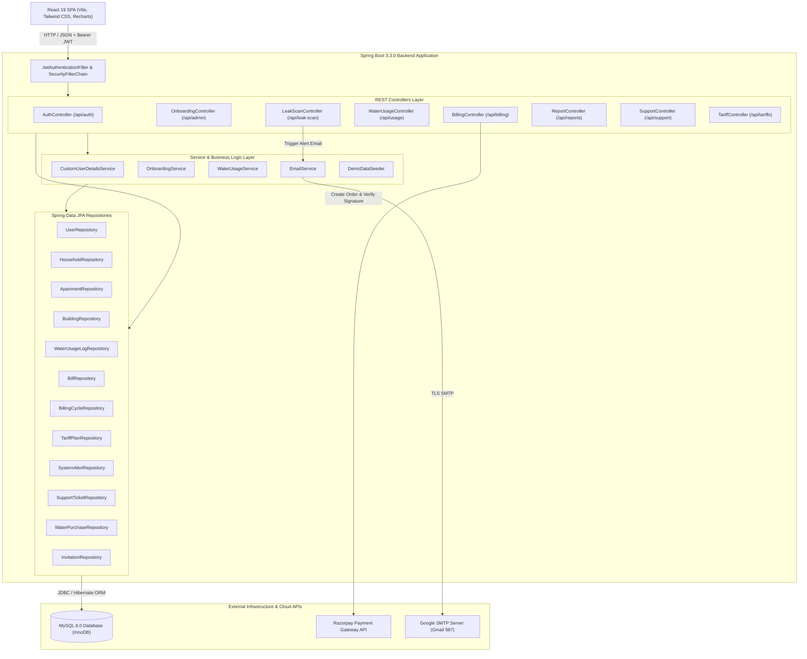
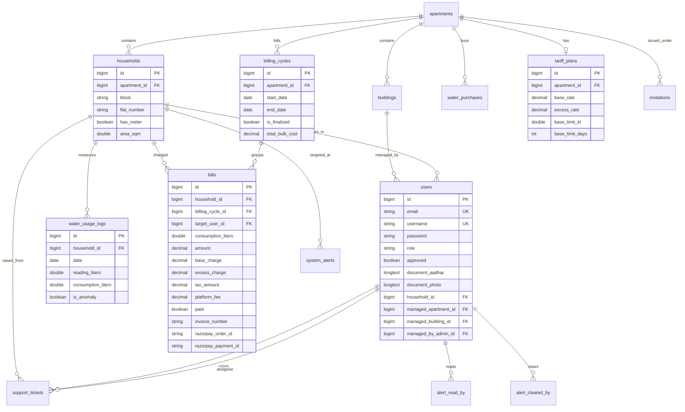

# AquaTrack — Comprehensive Technical Interview Preparation Dossier
**Target Role:** Fresher Software Developer / Java Backend Developer / Full Stack Software Engineer  
**System Analyzed:** AquaTrack — Water Management and Billing Administration Platform  
**Repository Branch/Stack:** Spring Boot 3.3.0 (Java 21), React 19 + Vite + Tailwind CSS v4, MySQL 8.0, Docker  

---

## Deliverable 1: Project Overview

### 1. Project Name & Problem Statement
- **Project Name:** AquaTrack (Water Monitoring & Billing Administration Platform)
- **Problem Statement:** In high-density residential housing societies, water management suffers from multiple systemic failures:
  1. **Unfair Flat-Rate Billing:** Without granular metering, households are charged flat maintenance fees regardless of actual consumption, disincentivizing conservation.
  2. **Unmetered Flat Inequity:** Complexes often have a mix of metered and unmetered units, making proportional cost estimation difficult.
  3. **Undetected Underground & Internal Leaks:** Continuous pipe bursts, running flush tanks, and tap leaks waste millions of liters before being physically noticed.
  4. **Manual Meter Reading Overhead:** Collecting monthly manual meter readings via pen and paper is error-prone and time-consuming.
  5. **Disjointed Tanker Logistics & Billing:** Societies purchasing third-party bulk water tankers struggle to reconcile tanker costs against tenant consumption.
- **AquaTrack's Solution:** A centralized, multi-tenant SaaS-style platform that digitizes tenant onboarding (with KYC document verification), automates bulk meter readings via CSV, calculates tiered and proportional water bills, detects leaks via statistical Z-score anomaly scanning, and integrates Razorpay payments and PDF generation.

### 2. Target Users & Use Cases
| User Role | System Role Name | Core Responsibilities & Use Cases |
| :--- | :--- | :--- |
| **Super Admin** | `ROLE_ADMIN` | Oversees all housing colonies/apartments, approves new Community Admins, configures global platform tariffs, views multi-colony consumption/financial audits, seeds demo data. |
| **Community Admin** | `ROLE_COMMUNITY_ADMIN` | Manages a specific apartment complex or building block, invites residents via secure tokens, verifies resident KYC documents, configures local tariff rules, bulk uploads meter readings via CSV templates, finalizes monthly billing cycles, runs statistical leak scans, logs tanker water purchases. |
| **Resident** | `ROLE_USER` | Enters system via admin invitation, tracks daily/monthly consumption charts, compares usage against society and flat-size averages, pays bills via Razorpay, downloads PDF invoices, reports issues via support tickets. |

---

## Deliverable 2: Technology Stack & High-Level Architecture

### Technology Stack Table
| Component | Technology | Purpose in AquaTrack | Evidence in Codebase |
| :--- | :--- | :--- | :--- |
| **Language** | Java 21 | Modern LTS Java language features (records, enhanced pattern matching, new HTTP client, strong typing). | [`pom.xml`](file:///c:/Users/rahul/OneDrive/Desktop/AquaTrack/water/pom.xml#L18) |
| **Backend Framework** | Spring Boot 3.3.0 | Core application runtime, DI/IoC container, MVC routing, dependency autoconfiguration. | [`pom.xml`](file:///c:/Users/rahul/OneDrive/Desktop/AquaTrack/water/pom.xml#L8) |
| **Persistence / ORM** | Spring Data JPA / Hibernate 6 | Object-Relational Mapping, entity lifecycle, JPQL queries, indexing, and repository abstraction. | [`pom.xml`](file:///c:/Users/rahul/OneDrive/Desktop/AquaTrack/water/pom.xml#L28) |
| **Security & Auth** | Spring Security 6 + JJWT 0.11.5 | Stateless REST security filter chain, BCrypt password hashing, HMAC SHA-256 JWT generation and validation. | [`SecurityConfig.java`](file:///c:/Users/rahul/OneDrive/Desktop/AquaTrack/water/src/main/java/com/water/water/security/SecurityConfig.java#L18-L87) |
| **Database** | MySQL 8.0 / PostgreSQL | Relational storage for users, households, bills, usage logs, alerts, and tickets. | [`application.properties`](file:///c:/Users/rahul/OneDrive/Desktop/AquaTrack/water/src/main/resources/application.properties#L11-L15) |
| **PDF Generation** | OpenPDF (LibrePDF 1.3.30) | Programmatic invoice generation with dynamic tables, styling, and streaming to byte array. | [`BillingController.java`](file:///c:/Users/rahul/OneDrive/Desktop/AquaTrack/water/src/main/java/com/water/water/controller/BillingController.java#L600-L750) |
| **Payment Gateway** | Razorpay Java SDK 1.4.3 | Server-side Razorpay order generation and HMAC-SHA256 signature verification. | [`BillingController.java`](file:///c:/Users/rahul/OneDrive/Desktop/AquaTrack/water/src/main/java/com/water/water/controller/BillingController.java#L508-L598) |
| **API Documentation** | SpringDoc OpenAPI 2.5.0 | Interactive Swagger UI (`/swagger-ui.html`) and OpenAPI 3 schema generation. | [`pom.xml`](file:///c:/Users/rahul/OneDrive/Desktop/AquaTrack/water/pom.xml#L70) |
| **Email Service** | Spring Mail (JavaMailSender) | Automated dispatch of high-usage anomaly alerts and system notices via SMTP. | [`EmailService.java`](file:///c:/Users/rahul/OneDrive/Desktop/AquaTrack/water/src/main/java/com/water/water/service/EmailService.java#L12-L34) |
| **Frontend Framework** | React 19 + Vite 8 | Single Page Application (SPA), component tree rendering, fast HMR bundling. | [`package.json`](file:///c:/Users/rahul/OneDrive/Desktop/AquaTrack/frontend/package.json#L15-L31) |
| **Styling & UI** | Tailwind CSS v4 + Lucide Icons | Responsive styling, animated canvas visualizers, theme toggling, UI icons. | [`frontend/package.json`](file:///c:/Users/rahul/OneDrive/Desktop/AquaTrack/frontend/package.json#L21) |
| **Data Visualization** | Recharts 3.9 | Interactive area charts, bar graphs, and consumption trend visualizers. | [`frontend/package.json`](file:///c:/Users/rahul/OneDrive/Desktop/AquaTrack/frontend/package.json#L17) |
| **Containerization** | Docker & Docker Compose | Multi-container orchestration (MySQL 8, Spring Boot backend, Vite frontend). | [`docker-compose.yml`](file:///c:/Users/rahul/OneDrive/Desktop/AquaTrack/docker-compose.yml#L1-L54) |
| **Cloud Deployment** | Render + Vercel | Render web service config for Spring Boot backend; Vercel routing for React frontend. | [`render.yaml`](file:///c:/Users/rahul/OneDrive/Desktop/AquaTrack/render.yaml#L1-L14) |
| **Load Testing** | k6 | Automated load testing script simulating concurrent usage submissions. | [`load_test.js`](file:///c:/Users/rahul/OneDrive/Desktop/AquaTrack/tests/load_test.js#L1-L39) |

---

### High-Level Architecture Diagram



---

## Deliverable 3: Important Files & Their Core Responsibilities

### Backend Files
1. [`WaterApplication.java`](file:///c:/Users/rahul/OneDrive/Desktop/AquaTrack/water/src/main/java/com/water/water/WaterApplication.java): Spring Boot bootstrap entry point. Contains `@SpringBootApplication` and initializes default timezones.
2. [`SecurityConfig.java`](file:///c:/Users/rahul/OneDrive/Desktop/AquaTrack/water/src/main/java/com/water/water/security/SecurityConfig.java): Declares the `SecurityFilterChain`, disables CSRF, sets session creation policy to `STATELESS`, registers CORS configuration, defines URL path role authorities, and injects `JwtAuthenticationFilter`.
3. [`JwtUtil.java`](file:///c:/Users/rahul/OneDrive/Desktop/AquaTrack/water/src/main/java/com/water/water/security/JwtUtil.java): Handles cryptographic signing (HMAC-SHA256) of JWT tokens, claim extraction, and expiration validation (10-hour default).
4. [`JwtAuthenticationFilter.java`](file:///c:/Users/rahul/OneDrive/Desktop/AquaTrack/water/src/main/java/com/water/water/security/JwtAuthenticationFilter.java): Extends `OncePerRequestFilter`. Intercepts incoming requests, extracts the `Bearer ` token from `Authorization` header, parses the username/email, and seeds the `SecurityContextHolder`.
5. [`CustomUserDetailsService.java`](file:///c:/Users/rahul/OneDrive/Desktop/AquaTrack/water/src/main/java/com/water/water/security/CustomUserDetailsService.java): Implements Spring Security's `UserDetailsService`. Provides dual-login capability by looking up users by either email OR username.
6. [`AuthController.java`](file:///c:/Users/rahul/OneDrive/Desktop/AquaTrack/water/src/main/java/com/water/water/controller/AuthController.java): Handles user registration, username availability checks, verification document submission, invitation token validation, login authentication, and profile retrieval.
7. [`BillingController.java`](file:///c:/Users/rahul/OneDrive/Desktop/AquaTrack/water/src/main/java/com/water/water/controller/BillingController.java): Manages billing cycle creation, cycle finalization with tiered tariff math and unmetered area calculations, Razorpay payment order creation and signature validation, and OpenPDF invoice streaming.
8. [`WaterUsageService.java`](file:///c:/Users/rahul/OneDrive/Desktop/AquaTrack/water/src/main/java/com/water/water/service/WaterUsageService.java): Core meter reading engine: logs single readings, parses multi-line CSV bulk uploads, recalculates daily consumption deltas, and computes apartment leaderboard rankings.
9. [`LeakScanController.java`](file:///c:/Users/rahul/OneDrive/Desktop/AquaTrack/water/src/main/java/com/water/water/controller/LeakScanController.java): Computes rolling 14-day sample means ($\mu$), sample standard deviations ($\sigma$), and Z-scores ($Z = \frac{x - \mu}{\sigma}$) to detect abnormal consumption surges and pipe leaks.
10. [`OnboardingService.java`](file:///c:/Users/rahul/OneDrive/Desktop/AquaTrack/water/src/main/java/com/water/water/service/OnboardingService.java): Coordinates community onboarding: creates colonies/apartments, creates buildings, manages resident invitations, and handles admin KYC approval workflows.
11. [`ReportController.java`](file:///c:/Users/rahul/OneDrive/Desktop/AquaTrack/water/src/main/java/com/water/water/controller/ReportController.java): Aggregates usage, purchases, and billing statistics across months and societies, generates downloadable PDF/CSV reports, and exposes the demo data seeder.
12. [`SupportController.java`](file:///c:/Users/rahul/OneDrive/Desktop/AquaTrack/water/src/main/java/com/water/water/controller/SupportController.java): Ticket lifecycle management: assigns resident tickets to Community Admins, Community Admin tickets to Super Admins, and triggers system alerts upon resolution.

### Frontend Files
1. [`frontend/src/App.jsx`](file:///c:/Users/rahul/OneDrive/Desktop/AquaTrack/frontend/src/App.jsx): Main application orchestrator managing view states, active tab navigation, JWT persistence in `localStorage`, and role-based dashboard rendering.
2. [`frontend/src/components/AquaBot.jsx`](file:///c:/Users/rahul/OneDrive/Desktop/AquaTrack/frontend/src/components/AquaBot.jsx): Custom client-side natural keyword/synonym conversational assistant supporting English and Hindi, context-aware query responses, and suggestions.
3. [`frontend/src/components/InvoiceModal.jsx`](file:///c:/Users/rahul/OneDrive/Desktop/AquaTrack/frontend/src/components/InvoiceModal.jsx): Modal for displaying detailed bill breakdowns, triggering Razorpay Checkout SDK, and downloading invoice PDFs.
4. [`frontend/src/components/RegistrationWizard.jsx`](file:///c:/Users/rahul/OneDrive/Desktop/AquaTrack/frontend/src/components/RegistrationWizard.jsx): Step-by-step registration wizard for Community Admins and Residents with document capture.
5. [`frontend/src/components/VerificationViews.jsx`](file:///c:/Users/rahul/OneDrive/Desktop/AquaTrack/frontend/src/components/VerificationViews.jsx): Dedicated UI for resident invitation verification and KYC status tracking.

---

## Deliverable 4: End-to-End Feature Walkthroughs

### Flow 1: Community Admin Registration & Super Admin Approval
1. **User Action:** A prospective society manager opens the registration wizard, selects `ROLE_COMMUNITY_ADMIN`, selects or creates a colony (Apartment) and building block, enters credentials, and submits.
2. **Backend Processing (`AuthController.registerUser`):**
   - Validates that email and username are unique.
   - Saves `User` entity with `role = ROLE_COMMUNITY_ADMIN` and `approved = false`.
   - Returns `userId` to the client for the subsequent KYC step.
3. **Document Upload (`AuthController.verifyAdminDocs`):**
   - User submits Base64-encoded Aadhaar document and photo.
   - Saves documents to `document_aadhar` and `document_photo` in `users` table.
   - Emits a `SystemAlert` with `type = "REGISTRATION"` to notify the Super Admin.
4. **Approval by Super Admin (`OnboardingService.approveUser`):**
   - Super Admin views pending approvals at `GET /api/admin/pending-approvals`.
   - Clicks approve (`POST /api/admin/approve-user/{userId}`).
   - `User.approved` is set to `true`. Community Admin can now log in and receive a JWT.

### Flow 2: Resident Invitation & Self-Onboarding
1. **Invitation Generation (`OnboardingService.inviteResident`):**
   - Community Admin enters resident name, email, apartment ID, block, and flat number.
   - Backend generates a secure random UUID token: `UUID.randomUUID().toString()`.
   - Saves an `Invitation` entity with status `PENDING`.
   - Dispatches an invitation link containing the token to the resident's email via `EmailService`.
2. **Token Verification (`AuthController.getInvitationDetails` & `verifyInvitation`):**
   - Resident opens the link: `GET /api/auth/invitation/{token}` returns pre-filled block and flat details.
   - Resident uploads KYC documents and personal details (`POST /api/auth/verify-invitation`), updating status to `VERIFIED`.
3. **Account Creation (`AuthController.registerInvited`):**
   - Resident provides password and optional username (`POST /api/auth/register-invited`).
   - Backend checks if `Household` exists for that flat; if not, creates one dynamically.
   - Creates `User` with `role = ROLE_USER`, `approved = false` (or pending admin review), links them to `Household`.
   - Updates `Invitation.status = "REGISTERED"` and generates a registration `SystemAlert`.

### Flow 3: Bulk Meter Reading & Water Consumption Delta Engine
1. **Template Download (`WaterUsageController.downloadBulkTemplate`):**
   - Admin requests CSV template for a date range (`GET /api/usage/bulk-template?startDate=...&endDate=...`).
   - Backend queries all metered households in the admin's apartment, looks up the latest previous meter reading, and generates a pre-formatted CSV with columns: `householdId,date,readingLiters,previousReading,residentName,apartment,block,flatNumber`.
2. **Upload & Parsing (`WaterUsageService.processBulkCsvUpload`):**
   - Admin fills in the cumulative meter readings and uploads the CSV (`POST /api/usage/bulk-upload`).
   - Service streams the file line-by-line using `BufferedReader`, dynamically identifying column indices.
   - For each row, checks if a log for `(householdId, date)` exists; updates reading if present, or creates a new `WaterUsageLog`.
3. **Delta Recalculation (`WaterUsageService.recalculateAllConsumption`):**
   - Groups all logs by `householdId` and sorts them chronologically: `Comparator.comparing(WaterUsageLog::getDate).thenComparing(WaterUsageLog::getId)`.
   - Row 0 (baseline reading) is assigned `consumptionLiters = 0.0`.
   - For each subsequent row $i$: $\text{consumption}_i = \max(0.0, \text{reading}_i - \text{reading}_{i-1})$.
   - Persists all updated entities to the database in bulk.

### Flow 4: Billing Cycle Calculation & Finalization
1. **Cycle Creation (`BillingController.createCycle`):**
   - Admin defines a period (e.g., 2026-03-01 to 2026-03-31) and optional tanker bulk cost.
   - Creates `BillingCycle` with `isFinalized = false`.
2. **Finalization Trigger (`BillingController.finalizeCycle`):**
   - Admin calls `POST /api/billing/cycle/{id}/finalize`.
   - Checks caller authority (`isAdmin`).
   - Retrieves active `TariffPlan` for the apartment.
   - Computes cycle duration in days: $\text{cycleDays} = \text{ChronoUnit.DAYS.between}(\text{startDate}, \text{endDate}) + 1$.
   - Computes proportional base limit: $\text{proportionalLimitKl} = \text{baseLimitKl} \times \left(\frac{\text{cycleDays}}{\text{baseLimitDays}}\right)$.
3. **Metered vs. Unmetered Flat Calculation:**
   - For metered flats: sums `consumptionLiters` from `water_usage_logs` between start and end dates.
   - Computes $\text{avgConsumptionPerSqm} = \frac{\sum \text{Metered Consumption}}{\sum \text{Metered Area Sqm}}$.
   - For unmetered flats: estimates consumption as $\text{estimatedConsumption} = \text{avgConsumptionPerSqm} \times \text{flatAreaSqm}$.
4. **Tiered Tariff Rate Application:**
   - $\text{baseLimitLiters} = \text{proportionalLimitKl} \times 1000.0$.
   - If $\text{consumption} \le \text{baseLimitLiters}$:
     $$\text{baseCost} = \text{baseRate} \times \frac{\text{consumption}}{1000.0}, \quad \text{excessCost} = 0$$
   - Else:
     $$\text{baseCost} = \text{baseRate} \times \frac{\text{baseLimitLiters}}{1000.0}, \quad \text{excessCost} = \text{excessRate} \times \frac{\text{consumption} - \text{baseLimitLiters}}{1000.0}$$
   - Tax (5% GST): $\text{taxAmount} = (\text{baseCost} + \text{excessCost}) \times 0.05$.
   - Platform Fee: fixed at ₹5.00.
   - Total Amount: $\text{subtotal} + \text{taxAmount} + \text{platformFee}$.
5. **Bill Generation:**
   - Generates unique invoice string: `INV-{year}-{100000 + householdId}-{billingCycleId}`.
   - Creates `Bill` entities, marks `BillingCycle.isFinalized = true`, and emits `SystemAlert` to residents.

### Flow 5: Payment Workflow with Razorpay & OpenPDF Invoicing
1. **Order Initiation (`BillingController.createRazorpayOrder`):**
   - Resident clicks "Pay with Razorpay" on an unpaid bill.
   - Backend converts bill amount to paise: $\text{amountInPaise} = \text{amount} \times 100$.
   - Calls Razorpay API: `razorpayClient.orders.create({ amount, currency: "INR", receipt: "inv_..." })`.
   - Saves `orderId` to `Bill.razorpayOrderId` and returns payload to client.
2. **Client Checkout & Signature Verification (`BillingController.verifyRazorpayPayment`):**
   - Razorpay Checkout modal handles payment and returns `razorpayPaymentId`, `razorpayOrderId`, and `razorpaySignature`.
   - Client submits these to `POST /api/billing/pay/razorpay/verify`.
   - Backend calls `com.razorpay.Utils.verifyPaymentSignature(options, razorpayKeySecret)`.
   - If signature is valid, updates `Bill.paid = true`, records `paymentDate`, and alerts admins.
3. **Invoice PDF Streaming (`BillingController.downloadBillPdf`):**
   - Resident clicks "Download Invoice": `GET /api/billing/bill/{billId}/pdf`.
   - Backend loads `Bill`, `Household`, `Apartment`, and `BillingCycle`.
   - Uses OpenPDF (`Document`, `PdfWriter`, `PdfPTable`) to build a formatted PDF in memory.
   - Returns `byte[]` with `Content-Type: application/pdf` and `Content-Disposition: attachment; filename="Invoice-..."`.

### Flow 6: Leak Detection Algorithm (Moving Average & Z-Score)
1. **Trigger (`LeakScanController.runLeakScan`):**
   - Admin accesses Leak Scan dashboard (`GET /api/leak-scan/scan`).
2. **Statistical Anomaly Calculation:**
   - For each household in the colony, loads up to 14 latest usage records: $x_1, x_2, \dots, x_N$.
   - Calculates baseline average: $\mu = \frac{1}{N}\sum_{i=1}^N x_i$.
   - Calculates variance and standard deviation:
     $$\sigma = \sqrt{\frac{1}{N}\sum_{i=1}^N (x_i - \mu)^2}$$
   - Calculates Z-score for latest reading $x_{\text{latest}}$:
     $$Z = \frac{x_{\text{latest}} - \mu}{\sigma}$$
3. **Threshold Classification:**
   - If $x_{\text{latest}} > 800\text{ L}$ or $Z > 3.0 \implies$ **CRITICAL** (Major Pipe Burst / Main Supply Surge).
   - If $x_{\text{latest}} > 500\text{ L}$ or $Z > 2.0$ or entity `isAnomaly == true` $\implies$ **HIGH** (Continuous Leak / Flapper).
   - Else $\implies$ **NORMAL**.
4. **Actionable Outputs:**
   - Returns estimated daily water loss (liters) and financial impact based on tariff excess rates.
   - Auto-dispatches warning email to resident via `EmailService.sendOveruseAlert`.

---

## Deliverable 5: Database & API Analysis

### Relational Entity-Relationship Diagram



### Database Tables & Indexing Strategy
| Table Name | Entity Class | Primary Key | Foreign Keys | Explicit Indexes in Code |
| :--- | :--- | :--- | :--- | :--- |
| `users` | `User` | `id` (IDENTITY) | `household_id`, `managed_apartment_id`, `managed_building_id`, `managed_by_admin_id` | Unique constraints on `email`, `username` |
| `apartments` | `Apartment` | `id` (IDENTITY) | None | Unique constraint on `name` |
| `buildings` | `Building` | `id` (IDENTITY) | `colony_id` | Foreign Key index |
| `households` | `Household` | `id` (IDENTITY) | `apartment_id` | Foreign Key index |
| `water_usage_logs` | `WaterUsageLog` | `id` (IDENTITY) | `household_id` | `idx_wul_household_date(household_id, date)`, `idx_wul_date(date)`, `idx_wul_anomaly(is_anomaly)` |
| `bills` | `Bill` | `id` (IDENTITY) | `household_id`, `billing_cycle_id`, `target_user_id` | `idx_bill_household_paid(household_id, paid)`, `idx_bill_cycle_paid(billing_cycle_id, paid)`, `idx_bill_invoice(invoice_number)` |
| `billing_cycles` | `BillingCycle` | `id` (IDENTITY) | `apartment_id` | Foreign Key index |
| `tariff_plans` | `TariffPlan` | `id` (IDENTITY) | `apartment_id` (1-to-1) | Unique constraint / FK on `apartment_id` |
| `system_alerts` | `SystemAlert` | `id` (IDENTITY) | `household_id`, `target_user_id` | Many-to-Many join tables: `alert_read_by`, `alert_cleared_by` |
| `invitations` | `Invitation` | `id` (IDENTITY) | `apartment_id` | `idx_invitation_email(email)`, `idx_invitation_token(token)` |
| `support_tickets`| `SupportTicket`| `id` (IDENTITY) | `raised_by_id`, `assigned_to_id` | Foreign Key indexes |
| `water_purchases`| `WaterPurchase`| `id` (IDENTITY) | `apartment_id` | Foreign Key index |

### Major API Endpoints Inventory
| Method | Endpoint | Authorized Roles | Request Body / Query Params | Response Description |
| :--- | :--- | :--- | :--- | :--- |
| `POST` | `/api/auth/register` | Public | `RegisterRequest` (JSON) | Creates user record; returns approval requirement. |
| `POST` | `/api/auth/login` | Public | `AuthRequest` (email/username + password) | Validates credentials, checks approval; returns JWT. |
| `GET` | `/api/auth/check-username` | Public | `?username=...` | Returns `{ available: boolean, message: string }`. |
| `GET` | `/api/auth/invitation/{token}` | Public | Path Variable: `token` | Returns invited flat/resident registration metadata. |
| `POST` | `/api/auth/verify-invitation` | Public | `{ token, documentAadhar, documentPhoto, ... }` | Sets invitation status to `VERIFIED`. |
| `POST` | `/api/auth/register-invited` | Public | `{ token, password, username }` | Creates resident account and links to household. |
| `GET` | `/api/usage/logs` | `USER`, `COMMUNITY_ADMIN`, `ADMIN` | None (reads auth context) | Returns scoped water usage records. |
| `POST` | `/api/usage/log` | `USER`, `COMMUNITY_ADMIN`, `ADMIN` | `WaterUsageRequest` | Saves manual reading; computes delta from previous reading. |
| `POST` | `/api/usage/bulk-upload` | `COMMUNITY_ADMIN`, `ADMIN` | `MultipartFile file` (CSV) | Batch processes readings; triggers delta recalculation. |
| `GET` | `/api/usage/bulk-template` | `COMMUNITY_ADMIN`, `ADMIN` | `?startDate=...&endDate=...` | Streams pre-filled CSV template with resident names. |
| `GET` | `/api/billing/bills` | `USER`, `COMMUNITY_ADMIN`, `ADMIN` | None (reads auth context) | Returns scoped bill records. |
| `POST` | `/api/billing/cycle` | `COMMUNITY_ADMIN`, `ADMIN` | `{ apartmentId, startDate, endDate, totalBulkCost }` | Creates an unfinalized billing cycle. |
| `POST` | `/api/billing/cycle/{id}/finalize` | `COMMUNITY_ADMIN`, `ADMIN` | Path Variable: `id` | Executes tiered billing math for all flats in cycle. |
| `POST` | `/api/billing/pay/razorpay/create-order/{billId}` | `USER`, `COMMUNITY_ADMIN`, `ADMIN` | Path Variable: `billId` | Creates Razorpay order in INR paise. |
| `POST` | `/api/billing/pay/razorpay/verify` | `USER`, `COMMUNITY_ADMIN`, `ADMIN` | `{ billId, razorpayOrderId, razorpayPaymentId, ... }` | Validates HMAC signature; marks bill as paid. |
| `GET` | `/api/billing/bill/{billId}/pdf` | `USER`, `COMMUNITY_ADMIN`, `ADMIN` | Path Variable: `billId` | Streams generated invoice PDF byte array. |
| `GET` | `/api/leak-scan/scan` | `COMMUNITY_ADMIN`, `ADMIN` | None (reads auth context) | Runs Z-score leak analysis across all flats. |
| `GET` | `/api/alerts` | `USER`, `COMMUNITY_ADMIN`, `ADMIN` | None (reads auth context) | Returns scoped system notifications and leak alerts. |
| `POST` | `/api/support/tickets` | `USER`, `COMMUNITY_ADMIN`, `ADMIN` | `SupportTicket` (JSON) | Creates issue ticket; routes to appropriate manager. |
| `POST` | `/api/admin/colony` | `ADMIN` (Super Admin) | `ColonyRequest` | Batch initializes Colony with buildings and flats. |

---

## Deliverable 6: Project-Specific Technical Interview Q&A Bank

### Category A: Project Introduction

#### Question A1: Explain your project in 30 seconds.
- **Difficulty:** Easy
- **Interview-ready answer:**  
  "AquaTrack is a full-stack water management and billing administration platform built with Spring Boot, React, and MySQL. It eliminates the inequities of flat-rate society maintenance by calculating tiered water bills for metered and unmetered apartments, automates bulk meter readings via CSV ingestion, detects hidden pipeline leaks using statistical Z-score anomaly scans, and provides an end-to-end payment workflow with Razorpay and PDF invoice generation."
- **Technical explanation:** Summarizes the architectural foundation (3-tier Spring Boot + React + MySQL), domain problem (inequitable flat-rate billing), and core engineering deliverables (tiered billing, CSV engine, Z-score leak detection, Razorpay/PDF).
- **Evidence from code:** Defined across [`pom.xml`](file:///c:/Users/rahul/OneDrive/Desktop/AquaTrack/water/pom.xml#L14-L15) and [`BillingController.java`](file:///c:/Users/rahul/OneDrive/Desktop/AquaTrack/water/src/main/java/com/water/water/controller/BillingController.java#L131-L279).
- **Likely follow-up:** *"What specific algorithm do you use to detect leaks?"*  
  *Answer:* "We calculate a rolling 14-day sample mean and standard deviation of daily consumption for each flat to compute a Z-score. If a flat's consumption exceeds 800 liters or has a Z-score greater than 3.0, it is flagged as a critical pipe burst."
- **Common mistake:** Describing it as a simple "CRUD billing site" instead of highlighting automated delta calculations, unmetered area estimations, and leak analytics.

---

#### Question A2: What problem does AquaTrack solve, and why is flat-rate water billing a problem?
- **Difficulty:** Easy
- **Interview-ready answer:**  
  "In most residential apartment societies, water charges are lumped into a single flat maintenance fee divided equally among all apartments. This creates an unfair subsidy where small, water-conscious families subsidize large, high-consumption households. Furthermore, unseen plumbing leaks—like running toilet flappers or cracked sub-meters—go completely unnoticed for months because there is no daily delta tracking. AquaTrack solves this by supporting multi-tenant tiered tariffs: households pay a baseline rate up to a quota, and an excess penalty rate beyond it, incentivizing conservation while automatically detecting abnormal consumption spikes."
- **Technical explanation:** In economics and municipal engineering, flat-rate resource distribution leads to the 'Tragedy of the Commons'. Tiered billing (increasing block tariffs) enforces consumption awareness. Unmetered flats are estimated proportionally using the average consumption per square meter of metered flats.
- **Evidence from code:** Metered vs. unmetered logic in [`BillingController.java`](file:///c:/Users/rahul/OneDrive/Desktop/AquaTrack/water/src/main/java/com/water/water/controller/BillingController.java#L209-L232).
- **Likely follow-up:** *"How do you handle flats that do not have water meters installed?"*  
  *Answer:* "We calculate the average water consumption per square meter across all metered flats in that colony ($\frac{\sum \text{Metered Liters}}{\sum \text{Metered Sqm}}$) and multiply that ratio by the unmetered flat's floor area."
- **Common mistake:** Saying unmetered flats are charged zero or flat-rate, without realizing the mathematical area-proportional estimation implemented in code.

---

#### Question A3: Why did you choose Spring Boot, React, and MySQL for this system?
- **Difficulty:** Medium
- **Interview-ready answer:**  
  "We selected **Spring Boot 3** because water management and financial billing demand strict transaction integrity, enterprise-grade role-based security via Spring Security filters, and first-class ORM mapping with Hibernate. **React** was chosen on the frontend to deliver a responsive, reactive single-page dashboard with interactive Recharts visualizations for multi-month consumption trends. **MySQL** was selected because water billing and KYC account records are strictly relational: bills, meters, apartments, and cycles require strict referential integrity, foreign key constraints, and ACID transactions during payment and cycle finalization."
- **Technical explanation:** Financial applications require ACID properties (Atomicity, Consistency, Isolation, Durability) to prevent partial payment state writes. A relational schema with foreign keys prevents orphaned records when apartments or cycles are modified.
- **Evidence from code:** `@Entity` relations in [`Bill.java`](file:///c:/Users/rahul/OneDrive/Desktop/AquaTrack/water/src/main/java/com/water/water/model/Bill.java#L21-L37) and `SecurityFilterChain` in [`SecurityConfig.java`](file:///c:/Users/rahul/OneDrive/Desktop/AquaTrack/water/src/main/java/com/water/water/security/SecurityConfig.java#L24-L87).
- **Likely follow-up:** *"Could this system have been built with MongoDB instead of MySQL?"*  
  *Answer:* "While MongoDB handles high-volume document ingestion well, billing systems require multi-table joins, relational cascades (e.g., deleting an unfinalized cycle deletes associated bills), and strict foreign key integrity between households, users, and payments. MySQL InnoDB provides atomic transactions and row-level locking, making it the safer choice for financial ledgers."
- **Common mistake:** Claiming MongoDB was avoided just because 'SQL is what we learned first'. Always justify based on ACID transactions, schema enforcement, and relational integrity.

---

### Category B: Architecture and Code

#### Question B1: Walk me through the architecture of AquaTrack from the frontend request to the database.
- **Difficulty:** Medium
- **Interview-ready answer:**  
  "AquaTrack follows a classic layered client-server architecture:
  1. **Client Layer:** A React SPA sends asynchronous HTTP requests using `fetch` with an `Authorization: Bearer <JWT>` header.
  2. **Security & Interception Layer:** The request hits Spring Security's filter chain. `JwtAuthenticationFilter` intercepts the request before it reaches the controller, extracts the token, validates the HMAC-SHA256 signature via `JwtUtil`, loads the user via `CustomUserDetailsService`, and sets the `SecurityContext`.
  3. **Controller Layer:** The request is routed to a `@RestController` (like `BillingController`), which handles request deserialization, parameter validation (`@Valid`), and HTTP status mapping.
  4. **Service / Business Logic Layer:** The controller delegates complex calculations (e.g., `WaterUsageService`) to `@Service` classes that compute consumption deltas and business rules.
  5. **Data Access Layer:** Services interact with Spring Data JPA `@Repository` interfaces, which translate method calls or JPQL queries into parameterized SQL queries executed against MySQL via HikariCP connection pooling."
- **Technical explanation:** Demonstrates separation of concerns (Presentation -> Security -> Controller -> Service -> DAO -> Database).
- **Evidence from code:** [`JwtAuthenticationFilter.java`](file:///c:/Users/rahul/OneDrive/Desktop/AquaTrack/water/src/main/java/com/water/water/security/JwtAuthenticationFilter.java#L28-L69), [`BillingController.java`](file:///c:/Users/rahul/OneDrive/Desktop/AquaTrack/water/src/main/java/com/water/water/controller/BillingController.java#L32), and [`WaterUsageService.java`](file:///c:/Users/rahul/OneDrive/Desktop/AquaTrack/water/src/main/java/com/water/water/service/WaterUsageService.java#L25-L26).
- **Likely follow-up:** *"Where are database connections managed?"*  
  *Answer:* "Spring Boot uses HikariCP as the default JDBC connection pool. It manages a pool of pre-established physical TCP connections to MySQL, avoiding the overhead of establishing a new socket connection on every HTTP request."
- **Common mistake:** Forgetting the `JwtAuthenticationFilter` step and jumping directly from React to the controller.

---

#### Question B2: How does AquaTrack handle role-based authorization across Super Admins, Community Admins, and Residents?
- **Difficulty:** Medium
- **Interview-ready answer:**  
  "Authorization is enforced at two distinct levels:
  1. **URL-Level Filter Chain (`SecurityConfig.java`):** We configure request matchers using `.hasAnyAuthority()`. For example, `/api/admin/**` is restricted to `ROLE_ADMIN` and `ROLE_COMMUNITY_ADMIN`, while resident bills `/api/billing/bills` allows `ROLE_USER`.
  2. **Data-Level Row Filtering (Controller/Service Layer):** Even if two users have permission to call an endpoint (like `GET /api/billing/bills`), they must not see each other's data. In `BillingController`, we extract the caller's email from `Authentication.getName()`. If the user is a `ROLE_USER`, we return only bills where `household_id == user.getHousehold().getId()`. If they are a `ROLE_COMMUNITY_ADMIN`, we filter bills by their managed apartment ID."
- **Technical explanation:** URL-level security only verifies *coarse-grained* permissions. *Fine-grained* multi-tenant data isolation must be enforced by scoping database queries to tenant ownership attributes (`managedApartmentId` or `householdId`), preventing Insecure Direct Object References (IDOR).
- **Evidence from code:** Endpoint rules in [`SecurityConfig.java`](file:///c:/Users/rahul/OneDrive/Desktop/AquaTrack/water/src/main/java/com/water/water/security/SecurityConfig.java#L38-L77) and scoped filtering in [`BillingController.java`](file:///c:/Users/rahul/OneDrive/Desktop/AquaTrack/water/src/main/java/com/water/water/controller/BillingController.java#L319-L362).
- **Likely follow-up:** *"What would happen if a resident manually forged an API request to `POST /api/billing/cycle`?"*  
  *Answer:* "`SecurityFilterChain` checks the authorities stored in their validated JWT. Since the token contains only `ROLE_USER` and the endpoint demands `COMMUNITY_ADMIN` or `ADMIN`, Spring Security immediately aborts the request with an HTTP 403 Forbidden before executing any controller code."
- **Common mistake:** Assuming URL-level security is enough and forgetting that residents shouldn't see other residents' bills.

---

### Category C: Programming, OOP, and Java 21 Concepts

#### Question C1: Which Object-Oriented Programming (OOP) concepts are used in this codebase? Give concrete examples.
- **Difficulty:** Medium
- **Interview-ready answer:**  
  "All four core OOP principles are actively used:
  1. **Encapsulation:** Entities like [`Bill.java`](file:///c:/Users/rahul/OneDrive/Desktop/AquaTrack/water/src/main/java/com/water/water/model/Bill.java#L20-L76) encapsulate private state (`amount`, `paid`, `consumptionLiters`) with Lombok-generated getters, setters, and JPA lifecycle hooks (`@PrePersist`).
  2. **Abstraction:** Repositories such as [`WaterUsageLogRepository`](file:///c:/Users/rahul/OneDrive/Desktop/AquaTrack/water/src/main/java/com/water/water/repository/WaterUsageLogRepository.java) extend Spring Data's `JpaRepository`. We interact with an abstract interface without writing raw JDBC SQL statements or connection management code.
  3. **Inheritance:** Filter classes like [`JwtAuthenticationFilter`](file:///c:/Users/rahul/OneDrive/Desktop/AquaTrack/water/src/main/java/com/water/water/security/JwtAuthenticationFilter.java#L19) inherit from Spring's `OncePerRequestFilter`, reusing HTTP request wrapping and filter chain dispatching while overriding `doFilterInternal()`.
  4. **Polymorphism:** The `UserDetailsService` interface in Spring Security is implemented by our custom [`CustomUserDetailsService`](file:///c:/Users/rahul/OneDrive/Desktop/AquaTrack/water/src/main/java/com/water/water/security/CustomUserDetailsService.java#L13). At runtime, Spring Security polymorphically invokes our `loadUserByUsername()` method during token authentication."
- **Technical explanation:** Demonstrates mapping textbook concepts (Encapsulation, Abstraction, Inheritance, Polymorphism) directly to framework patterns (JPA entities, Spring Data interfaces, Servlet filters, and Service providers).
- **Evidence from code:** Listed in the file references above.
- **Likely follow-up:** *"Why use `OncePerRequestFilter` instead of a standard `GenericFilterBean`?"*  
  *Answer:* "`OncePerRequestFilter` guarantees that the filter's logic executes exactly once per request dispatch, preventing redundant authentication checks if a request is internally forwarded or dispatched across servlet error handlers."
- **Common mistake:** Giving abstract textbook animal/car examples instead of actual classes from the project.

---

#### Question C2: Explain how the delta water consumption algorithm works, and analyze its time and space complexity.
- **Difficulty:** Medium
- **Interview-ready answer:**  
  "In `WaterUsageService.recalculateAllConsumption()`, water meters record cumulative readings (e.g., 10,000L, then 10,250L). To find actual consumption, we must compute deltas:
  1. We retrieve all usage logs and group them by `householdId` into a `Map<Long, List<WaterUsageLog>>`.
  2. For each household, we sort the logs chronologically by `date` ascending, and then by `id` ascending.
  3. The first log ($i=0$) is the baseline, so its `consumptionLiters` is set to `0.0`.
  4. For every subsequent log $i$, consumption is calculated as:
     $$\text{consumption}_i = \max(0.0, \text{reading}_i - \text{reading}_{i-1})$$
  
  **Complexity Analysis:**
  - **Time Complexity:** If there are $H$ households and $M$ logs per household ($N = H \times M$ total logs), grouping takes $O(N)$. Sorting each household's list takes $O(H \times (M \log M)) = O(N \log M)$. The sequential delta pass is $O(N)$. Thus, total time complexity is $O(N \log M)$, where $M$ is the number of logs per flat (e.g., 30 for a monthly cycle).
  - **Space Complexity:** $O(N)$ auxiliary space to hold the grouped HashMap and sorted lists in JVM heap memory before saving."
- **Technical explanation:** Handles edge cases where meter resets or replacement occurs by wrapping with $\max(0.0, \Delta)$ so consumption never becomes negative.
- **Evidence from code:** [`WaterUsageService.java`](file:///c:/Users/rahul/OneDrive/Desktop/AquaTrack/water/src/main/java/com/water/water/service/WaterUsageService.java#L427-L470).
- **Likely follow-up:** *"How would this perform if there are 1,000,000 logs?"*  
  *Answer:* "Loading all 1 million entities into JVM heap memory with `findAll()` would cause high memory pressure and potential `OutOfMemoryError`. In production, this should be refactored using SQL window functions: `SELECT id, reading_liters - LAG(reading_liters, 1, reading_liters) OVER (PARTITION BY household_id ORDER BY date ASC) as consumption FROM water_usage_logs` directly in MySQL."
- **Common mistake:** Claiming the complexity is $O(N^2)$ without recognizing that the logs are partitioned per household and sorted once.

---

#### Question C3: How does the statistical Z-score leak detection algorithm work?
- **Difficulty:** Hard
- **Interview-ready answer:**  
  "In [`LeakScanController.runLeakScan`](file:///c:/Users/rahul/OneDrive/Desktop/AquaTrack/water/src/main/java/com/water/water/controller/LeakScanController.java#L86-L125), we scan for plumbing leaks by comparing a flat's latest reading against its own historical baseline:
  1. We fetch up to 14 recent daily logs for a household.
  2. We compute the historical sample mean: $\mu = \frac{\sum x_i}{N}$. If $\mu < 50$L, we enforce a sensible minimum baseline of 150L.
  3. We compute the variance $\sigma^2 = \frac{\sum (x_i - \mu)^2}{N}$ and take its square root to find the standard deviation $\sigma$ (enforcing a minimum floor of 20L to avoid division by zero).
  4. We compute the standard Z-score:
     $$Z = \frac{x_{\text{latest}} - \mu}{\sigma}$$
  5. If $x_{\text{latest}} > 800$L or $Z > 3.0$ (meaning consumption is more than 3 standard deviations above normal), it is classified as a **CRITICAL** leak (e.g., pipe burst). If $x_{\text{latest}} > 500$L or $Z > 2.0$, it is classified as a **HIGH** risk leak (continuous flapper leak). An automated alert is generated and an email is triggered."
- **Technical explanation:** Normal distribution outlier detection (the 68-95-99.7 Empirical Rule). In a normal Gaussian distribution, $99.7\%$ of data falls within $\mu \pm 3\sigma$. Any reading where $Z > 3.0$ represents a statistical anomaly occurring less than $0.3\%$ of the time by chance.
- **Evidence from code:** Lines 86–125 in [`LeakScanController.java`](file:///c:/Users/rahul/OneDrive/Desktop/AquaTrack/water/src/main/java/com/water/water/controller/LeakScanController.java#L86-L125).
- **Likely follow-up:** *"Why enforce a minimum standard deviation floor ($\sigma \ge 20$L)?"*  
  *Answer:* "If a resident consumes exactly the same amount of water every day (e.g., 100L every day for 14 days), the variance would be 0, leading to a division-by-zero error (`NaN` or `Infinity`). Enforcing $\sigma \ge 20.0$ guarantees numeric stability."
- **Common mistake:** Saying that leaks are detected only by an `if (liters > 500)` threshold, ignoring the statistical Z-score normalization.

---

### Category D: Database and SQL

#### Question D1: Explain the database indexing strategy in AquaTrack. Which indexes were created and why?
- **Difficulty:** Hard
- **Interview-ready answer:**  
  "We created composite and single-column indexes on high-frequency query paths:
  1. **`water_usage_logs`:**
     - `@Index(name = "idx_wul_household_date", columnList = "household_id, date")`: Queries constantly filter by a household within a billing cycle's date range (`date >= start AND date <= end`). A composite index on `(household_id, date)` satisfies both conditions via a B-Tree range scan without a full table scan.
     - `@Index(name = "idx_wul_date", columnList = "date")`: Optimizes system-wide reporting and monthly aggregation queries.
     - `@Index(name = "idx_wul_anomaly", columnList = "is_anomaly")`: Allows fast lookup of unaddressed anomaly logs for admin dashboards.
  2. **`bills`:**
     - `@Index(name = "idx_bill_household_paid", columnList = "household_id, paid")`: The resident dashboard immediately queries `WHERE household_id = ? AND paid = false` to show unpaid dues.
     - `@Index(name = "idx_bill_cycle_paid", columnList = "billing_cycle_id, paid")`: The admin dashboard queries cycle completion status.
     - `@Index(name = "idx_bill_invoice", columnList = "invoice_number")`: Guarantees $O(1)$ lookups when searching or downloading an invoice by number."
- **Technical explanation:** A B-Tree composite index on `(A, B)` allows index seeks on queries filtering by `A` alone or `A AND B` (leftmost prefix rule). Indexing `(household_id, date)` reduces query execution time from $O(N)$ full table scan to $O(\log N + K)$ index seek and scan.
- **Evidence from code:** Model index annotations in [`WaterUsageLog.java`](file:///c:/Users/rahul/OneDrive/Desktop/AquaTrack/water/src/main/java/com/water/water/model/WaterUsageLog.java#L13-L17) and [`Bill.java`](file:///c:/Users/rahul/OneDrive/Desktop/AquaTrack/water/src/main/java/com/water/water/model/Bill.java#L14-L18).
- **Likely follow-up:** *"Can an index on `(household_id, date)` be used by a query that only filters on `date`?"*  
  *Answer:* "No. Under the B-Tree leftmost prefix rule, MySQL cannot use a composite index `(household_id, date)` if the leading column `household_id` is omitted from the `WHERE` clause. That is why we also added a standalone index on `date` (`idx_wul_date`)."
- **Common mistake:** Thinking indexes speed up every database operation. In reality, indexes add write overhead during `INSERT` and `UPDATE` operations because the B-Tree must be balanced.

---

#### Question D2: Write an optimized SQL query to calculate the total water consumption and unpaid dues for every flat in an apartment for a given month.
- **Difficulty:** Medium
- **Interview-ready answer:**  
  "Here is the standard SQL query joining households, usage logs, and bills:
  ```sql
  SELECT 
      h.id AS household_id,
      h.block,
      h.flat_number,
      COALESCE(SUM(wul.consumption_liters), 0.0) AS total_liters_consumed,
      COALESCE(SUM(CASE WHEN b.paid = FALSE THEN b.amount ELSE 0.0 END), 0.0) AS total_unpaid_amount
  FROM households h
  LEFT JOIN water_usage_logs wul 
      ON h.id = wul.household_id 
      AND wul.date >= '2026-03-01' AND wul.date <= '2026-03-31'
  LEFT JOIN bills b 
      ON h.id = b.household_id
  WHERE h.apartment_id = :apartmentId
  GROUP BY h.id, h.block, h.flat_number
  ORDER BY h.block ASC, h.flat_number ASC;
  ```
  We use `LEFT JOIN` so flats that had zero consumption or no bills are still returned in the result set with `COALESCE` replacing nulls with `0.0`."
- **Technical explanation:** Explains `LEFT JOIN` vs `INNER JOIN`, conditional aggregation using `SUM(CASE WHEN ...)`, and grouping by primary keys.
- **Evidence from code:** Relates to queries in [`HouseholdRepository.java`](file:///c:/Users/rahul/OneDrive/Desktop/AquaTrack/water/src/main/java/com/water/water/repository/HouseholdRepository.java) and [`WaterUsageLogRepository.java`](file:///c:/Users/rahul/OneDrive/Desktop/AquaTrack/water/src/main/java/com/water/water/repository/WaterUsageLogRepository.java).
- **Likely follow-up:** *"What happens if a flat has multiple unpaid bills? Will the join multiply consumption rows?"*  
  *Answer:* "Yes, joining both `water_usage_logs` and `bills` in the same multi-table join produces a Cartesian product between logs and bills. To prevent duplicate sum inflation, it is safer to aggregate them in separate subqueries or CTEs before joining to `households`."
- **Common mistake:** Using `INNER JOIN` which would exclude empty flats or new flats that haven't received their first bill yet.

---

### Category E: APIs, Backend, and Web Architecture

#### Question E1: Explain the complete JWT authentication and validation lifecycle in AquaTrack.
- **Difficulty:** Medium
- **Interview-ready answer:**  
  "1. **Login Request:** The user posts credentials (`email` or `username` + `password`) to `/api/auth/login`.
  2. **Credential Resolution & Authentication:** `AuthController` resolves the identifier to a canonical email via `UserRepository.findByEmailOrUsername`. Spring Security's `AuthenticationManager` verifies the raw password against the BCrypt hash.
  3. **Approval Verification:** The user's `isApproved()` boolean is checked. If false, login is blocked with HTTP 403.
  4. **Token Generation:** `JwtUtil.generateToken()` embeds the email as the subject, along with role claims and an expiration timestamp (10 hours), signed using HMAC-SHA256 and the application secret key. The JWT is returned to the client.
  5. **Subsequent API Calls:** The client stores the JWT in `localStorage` and sends it in the `Authorization: Bearer <token>` header.
  6. **Filter Interception:** `JwtAuthenticationFilter` intercepts each request, parses the token, validates that the subject matches and the expiration date is in the future, and loads authorities into `SecurityContextHolder.getContext().setAuthentication(authToken)`."
- **Technical explanation:** Stateless authentication. The server does not maintain server-side sessions (`SessionCreationPolicy.STATELESS`), meaning any horizontally scaled backend instance can validate requests independently without session replication.
- **Evidence from code:** [`AuthController.java`](file:///c:/Users/rahul/OneDrive/Desktop/AquaTrack/water/src/main/java/com/water/water/controller/AuthController.java#L458-L487), [`JwtUtil.java`](file:///c:/Users/rahul/OneDrive/Desktop/AquaTrack/water/src/main/java/com/water/water/security/JwtUtil.java#L63-L85), and [`JwtAuthenticationFilter.java`](file:///c:/Users/rahul/OneDrive/Desktop/AquaTrack/water/src/main/java/com/water/water/security/JwtAuthenticationFilter.java#L38-L65).
- **Likely follow-up:** *"How do you handle token revocation if a user logs out or is deactivated?"*  
  *Answer:* "Because JWTs are stateless, they remain cryptographically valid until expiration unless revoked. To support immediate revocation, we can implement a Redis-backed token denylist (blocklist) or store a `token_version` timestamp on the `User` entity to reject tokens issued before a revocation event."
- **Common mistake:** Claiming the server stores the JWT in the database on every request.

---

#### Question E2: How does the Razorpay payment integration work, and how do you prevent payment tampering?
- **Difficulty:** Hard
- **Interview-ready answer:**  
  "Payment follows a secure two-step server-verified process:
  1. **Order Creation on Server:** When a user initiates payment, the client calls `POST /api/billing/pay/razorpay/create-order/{billId}`. The backend retrieves the authoritative bill amount from the database, converts it to paise, and creates an order using the official Razorpay SDK (`razorpayClient.orders.create(...)`). The server stores the `razorpayOrderId` on the `Bill` entity and returns the order ID to the client.
  2. **Client Checkout:** The React frontend opens the Razorpay Checkout modal with the order ID. The resident enters their payment details directly on Razorpay's PCI-DSS compliant interface.
  3. **Server-Side Cryptographic Signature Verification:** After payment, Razorpay returns a `razorpayPaymentId`, `razorpayOrderId`, and `razorpaySignature`. The client posts these to `POST /api/billing/pay/razorpay/verify`. The backend verifies the HMAC-SHA256 signature:
     $$\text{Signature} = \text{HMAC-SHA256}(\text{order\_id} + "|" + \text{payment\_id}, \text{razorpayKeySecret})$$
     Only if the calculated hash matches `razorpaySignature` does the server mark the bill as `paid = true`."
- **Technical explanation:** Signature verification ensures that a malicious client cannot forge an HTTP 200 payload or intercept the network request to mark a bill paid without actual settlement through Razorpay.
- **Evidence from code:** [`BillingController.java`](file:///c:/Users/rahul/OneDrive/Desktop/AquaTrack/water/src/main/java/com/water/water/controller/BillingController.java#L508-L598).
- **Likely follow-up:** *"What happens if the resident closes the browser after payment but before the verify endpoint is called?"*  
  *Answer:* "In production, relying solely on client callbacks creates dropped payment states. We should implement a **Razorpay Webhook endpoint** that receives direct server-to-server HTTP POST notifications from Razorpay (`payment.captured`) to mark the bill paid asynchronously."
- **Common mistake:** Trusting a client-side boolean `isSuccess` instead of verifying the cryptographic HMAC signature on the backend.

---

### Category F: Security & Vulnerability Evaluation

#### Question F1: Are there any security weaknesses or architectural risks in the current codebase? How would you fix them?
- **Difficulty:** Hard
- **Interview-ready answer:**  
  "During my code review of the repository, I identified four key security and architectural areas for improvement:
  1. **PermitAll on Demo Data Endpoint:** In [`SecurityConfig.java`](file:///c:/Users/rahul/OneDrive/Desktop/AquaTrack/water/src/main/java/com/water/water/security/SecurityConfig.java#L71), `/api/reports/seed-demo-data` is configured with `.permitAll()`. Anyone without authentication can trigger demo data generation.  
     *Fix:* Restrict it strictly to `hasAuthority('ROLE_ADMIN')` or disable it in production profiles.
  2. **Unprotected Direct Pay Endpoint:** In [`BillingController.java`](file:///c:/Users/rahul/OneDrive/Desktop/AquaTrack/water/src/main/java/com/water/water/controller/BillingController.java#L479-L506), the fallback endpoint `@PostMapping("/pay/{billId}")` marks any bill as paid without checking user ownership or requiring an admin role. Any logged-in resident can mark another resident's bill paid.  
     *Fix:* Require `ROLE_ADMIN` or enforce Razorpay signature verification.
  3. **Hardcoded Test Token Bypass:** In [`AuthController.java`](file:///c:/Users/rahul/OneDrive/Desktop/AquaTrack/water/src/main/java/com/water/water/controller/AuthController.java#L255-L275), there is backdoor test code: if a token contains `'test'` or `'demo'`, it synthesizes a mock invitation.  
     *Fix:* Remove mock bypasses from production controllers and restrict them to unit tests.
  4. **Base64 Document Storage in Database:** Storing Aadhaar cards and photos as Base64 strings in `LONGTEXT` columns causes MySQL buffer bloat and excessive heap consumption.  
     *Fix:* Upload documents to an S3-compatible object store (e.g., AWS S3, Cloudflare R2) and store only the secure pre-signed URL or object key in MySQL."
- **Technical explanation:** Demonstrates candid, senior-level code review ability. Distinguishes between working prototype shortcuts and production security hardening.
- **Evidence from code:** Cited above in [`SecurityConfig.java`](file:///c:/Users/rahul/OneDrive/Desktop/AquaTrack/water/src/main/java/com/water/water/security/SecurityConfig.java#L71), [`BillingController.java`](file:///c:/Users/rahul/OneDrive/Desktop/AquaTrack/water/src/main/java/com/water/water/controller/BillingController.java#L479), and [`AuthController.java`](file:///c:/Users/rahul/OneDrive/Desktop/AquaTrack/water/src/main/java/com/water/water/controller/AuthController.java#L255).
- **Likely follow-up:** *"How does the application protect against SQL Injection?"*  
  *Answer:* "We use Spring Data JPA and Hibernate, which compile queries into parameterized JDBC `PreparedStatement`s. User inputs are treated strictly as query literals rather than executable SQL code, preventing classical SQL injection."
- **Common mistake:** Claiming the code has zero vulnerabilities. Interviewers respect candidates who can identify real technical debt in their projects.

---

### Category G: Scenario-Based Engineering Questions

#### Question G1: What happens if 1,000 users simultaneously log in and submit water meter readings? How would the system hold up?
- **Difficulty:** Hard
- **Interview-ready answer:**  
  "Under a 1,000 concurrent user surge, several bottlenecks would emerge:
  1. **Thread Pool Exhaustion:** Spring Boot uses an embedded Tomcat server with a default pool of 200 worker threads (`server.tomcat.threads.max=200`). 1,000 concurrent requests would queue in the accept queue (`accept-count=100`), increasing response latency.
  2. **Database Connection Pool Exhaustion:** HikariCP defaults to a maximum pool size of 10 connections (`maximum-pool-size=10`). 200 threads competing for 10 DB connections would experience connection acquisition timeouts (`SQLTransientConnectionException`).
  3. **In-Memory Filtering:** In [`WaterUsageService.processBulkCsvUpload`](file:///c:/Users/rahul/OneDrive/Desktop/AquaTrack/water/src/main/java/com/water/water/service/WaterUsageService.java#L146) and `recalculateAllConsumption()`, the code calls `waterUsageLogRepository.findAll()`. Executing `findAll()` concurrently across multiple threads would saturate JVM heap memory.
  
  **How to Scale:**
  - Increase HikariCP pool size in `application.properties` to match database CPU core limits.
  - Replace `findAll().stream().filter(...)` with targeted indexed SQL queries (`findByHouseholdIdAndDate`).
  - Deploy multiple instances of the Spring Boot container behind an NGINX load balancer.
  - Implement a message queue like RabbitMQ or Kafka to decouple meter reading ingestion: incoming readings are acknowledged immediately with HTTP 202 Accepted and processed asynchronously by worker consumers."
- **Technical explanation:** Covers the concurrency funnel: Network Sockets -> Tomcat Worker Threads -> HikariCP Pool -> MySQL Engine -> CPU/RAM saturation.
- **Evidence from code:** Default configs in [`application.properties`](file:///c:/Users/rahul/OneDrive/Desktop/AquaTrack/water/src/main/resources/application.properties) and load test script [`load_test.js`](file:///c:/Users/rahul/OneDrive/Desktop/AquaTrack/tests/load_test.js).
- **Likely follow-up:** *"Why not just set the Hikari connection pool size to 1,000?"*  
  *Answer:* "Database connections are expensive OS processes that consume RAM, disk I/O, and CPU context switching on the MySQL server. Following the PostgreSQL/HikariCP formula $\text{Connections} = (\text{Core Count} \times 2) + \text{Spindle Count}$, setting a pool too high degrades database throughput through excessive CPU context thrashing."
- **Common mistake:** Simply saying 'I will increase RAM on the server' without addressing connection pooling, thread limits, or database queries.

---

#### Question G2: How do you prevent duplicate billing if an admin accidentally clicks 'Finalize Cycle' twice?
- **Difficulty:** Medium
- **Interview-ready answer:**  
  "We prevent duplicate billing using both database state flags and transactional safeguards:
  1. **Entity State Guard:** In [`BillingController.finalizeCycle`](file:///c:/Users/rahul/OneDrive/Desktop/AquaTrack/water/src/main/java/com/water/water/controller/BillingController.java#L137-L139), the very first check is:
     ```java
     if (cycle.isFinalized()) {
         return ResponseEntity.badRequest().body("Error: Billing cycle is already finalized!");
     }
     ```
  2. **Atomic Invoicing:** Invoices follow a deterministic naming convention:
     `INV-{year}-{100000 + householdId}-{billingCycleId}`.
  3. **Recommended Production Improvement:** To make this completely resilient against concurrent race conditions, we should:
     - Add `@Transactional` to the method so all bill insertions and the cycle status update commit atomically.
     - Add a database unique constraint on `bills(household_id, billing_cycle_id)`. If two concurrent threads pass the `isFinalized()` check simultaneously, the second thread will trigger a `DataIntegrityViolationException` and roll back cleanly."
- **Technical explanation:** Explains the Check-Then-Act race condition. Application-level `if (!isFinalized)` checks are vulnerable to concurrency without database unique constraints or row-level pessimistic locking (`SELECT ... FOR UPDATE`).
- **Evidence from code:** [`BillingController.java`](file:///c:/Users/rahul/OneDrive/Desktop/AquaTrack/water/src/main/java/com/water/water/controller/BillingController.java#L137-L139) and [`Bill.java`](file:///c:/Users/rahul/OneDrive/Desktop/AquaTrack/water/src/main/java/com/water/water/model/Bill.java#L14-L18).
- **Likely follow-up:** *"What is the difference between optimistic locking and pessimistic locking?"*  
  *Answer:* "Optimistic locking uses a `@Version` timestamp/number column; it assumes conflicts are rare and throws an `OptimisticLockException` on commit if another transaction updated the row. Pessimistic locking issues a `SELECT ... FOR UPDATE` lock directly on the database row, blocking other transactions until the lock is released."
- **Common mistake:** Claiming that a simple Java `if` condition completely prevents duplicate transactions under multi-threaded concurrency.

---

### Category H: Testing, Deployment, and DevOps

#### Question H1: How is the application deployed and containerized?
- **Difficulty:** Medium
- **Interview-ready answer:**  
  "AquaTrack is containerized using Docker and Docker Compose:
  1. **Multi-Stage Dockerfile (`water/Dockerfile`):**
     - **Build Stage:** Uses `maven:3.9-eclipse-temurin-21-alpine` to compile source code and package the Spring Boot executable fat JAR (`mvn clean package -DskipTests`).
     - **Runtime Stage:** Uses a minimal `eclipse-temurin:21-jre-alpine` runtime image, copies only the compiled JAR, exposes port 8080, and runs `java -jar app.jar`. This reduces image size from ~800MB to ~250MB.
  2. **Docker Compose Orchestration (`docker-compose.yml`):**
     - Runs three linked services on a private bridge network (`aquatrack-network`): `db` (MySQL 8.0 with persistent named volume `mysqldata`), `backend` (Spring Boot), and `frontend` (React/Vite).
     - Backend environment variables dynamically inject `SPRING_DATASOURCE_URL=jdbc:mysql://db:3306/water_billing_db`.
  3. **Cloud Production (`render.yaml`):**
     - Configured as a Render Web Service pointing to `water/Dockerfile`, binding dynamically to `${PORT:8080}` with `/health` health checks."
- **Technical explanation:** Multi-stage Docker builds separate build dependencies (Maven, JDK, source files) from runtime environments (JRE), minimizing attack surface and deployment footprint.
- **Evidence from code:** [`water/Dockerfile`](file:///c:/Users/rahul/OneDrive/Desktop/AquaTrack/water/Dockerfile#L1-L29), [`docker-compose.yml`](file:///c:/Users/rahul/OneDrive/Desktop/AquaTrack/docker-compose.yml#L1-L54), and [`render.yaml`](file:///c:/Users/rahul/OneDrive/Desktop/AquaTrack/render.yaml#L1-L14).
- **Likely follow-up:** *"Why use `-Djava.security.egd=file:/dev/./urandom` in the Docker ENTRYPOINT?"*  
  *Answer:* "It instructs the JVM to use non-blocking `/dev/urandom` instead of blocking `/dev/random` for cryptographic entropy, preventing Spring Boot startup delays inside containerized Linux environments."
- **Common mistake:** Not knowing how the backend connects to the MySQL container inside Docker (using the service name `db:3306` instead of `localhost:3306`).

---

### Category I: Individual Contribution & Ownership

#### Question I1: What was the most technically challenging problem you solved in this codebase?
- **Difficulty:** Hard
- **Interview-ready answer (Candidate to speak from experience):**  
  "The hardest technical problem was developing the **unmetered household estimation and proportional tiered billing engine** in [`BillingController.finalizeCycle`](file:///c:/Users/rahul/OneDrive/Desktop/AquaTrack/water/src/main/java/com/water/water/controller/BillingController.java#L131-L256). In our society, not all flats have functional water meters, yet costs must be distributed fairly. First, I had to compute a proportional base limit that dynamically scales based on whether the billing cycle was 7 days or 30 days. Second, for unmetered flats, I designed an algorithm that aggregates the metered consumption of all metered flats and divides it by their total surface area ($\text{sqm}$) to calculate an average consumption per square meter. That ratio is then multiplied by the unmetered flat's individual floor area. Getting the BigDecimal rounding and scale right while avoiding cumulative floating-point errors across base charges, excess rates, platform fees, and 5% GST was a great learning experience."
- **Technical explanation:** Demonstrates mastery over financial rounding, edge cases (zero metered area fallback), dynamic cycle scaling, and proportional math.
- **Evidence from code:** [`BillingController.java`](file:///c:/Users/rahul/OneDrive/Desktop/AquaTrack/water/src/main/java/com/water/water/controller/BillingController.java#L180-L240).
- **Likely follow-up:** *"Why use `BigDecimal` instead of `double` for currency?"*  
  *Answer:* "`double` and `float` use binary IEEE 754 floating-point representations, which cannot precisely represent fractional decimal numbers like $0.1$ or $0.05$. In financial ledgers, accumulating floating-point rounding errors leads to missing or extra cents. `BigDecimal` provides arbitrary-precision decimal arithmetic with explicit rounding modes (`RoundingMode.HALF_UP`)."
- **Common mistake:** Claiming that simple CSS styling or basic CRUD forms were the hardest problem. Focus on the algorithmic and financial calculations.

---

## Deliverable 7: Scenario-Based Engineering Questions

### Scenario 1: The database crashes mid-way through finalizing a billing cycle with 500 flats. What happens, and how do you recover?
- **Current Behavior:** The controller runs a standard Java loop without an explicit `@Transactional` boundary around the cycle finalization loop. If it crashes on flat 250, 249 bills exist in the database, but `BillingCycle.isFinalized` remains `false`. If the admin retries, duplicate bills would be generated for the first 249 flats.
- **Architectural Solution:**
  1. Annotate the service method with `@Transactional(rollbackFor = Exception.class)`. If the database crashes, Spring's transaction manager instructs the MySQL InnoDB engine to execute a rollback using undo logs, leaving the database in its clean prior state.
  2. Implement an idempotent compensation query: before creating a bill for flat $H$ in cycle $C$, verify if a bill already exists (`billRepository.findByBillingCycleIdAndHouseholdId(C, H)`).

### Scenario 2: How would you debug an API endpoint that suddenly takes 8 seconds to respond?
- **Structured Debugging Workflow:**
  1. **Reproduce & Trace:** Check server logs and inspect APM / Spring Boot Actuator traces to identify which layer takes time: the database, JVM processing, or an external API call (e.g., Razorpay or SMTP).
  2. **Database Query Profiling:** Enable Hibernate SQL logging (`spring.jpa.show-sql=true` and `spring.jpa.properties.hibernate.format_sql=true`) or examine the MySQL Slow Query Log (`long_query_time=1`). Run `EXPLAIN ANALYZE` on the query to see if a full table scan (`ALL`) is occurring due to a missing index.
  3. **Check for N+1 Query Problem:** In JPA, accessing a lazy-loaded collection (e.g., iterating through `households` and calling `h.getApartment().getName()`) triggers $N$ additional SQL queries. Fix with `JOIN FETCH` or `@EntityGraph`.
  4. **JVM Profiling:** If the query is fast but the endpoint is slow, take a thread dump (`jstack`) or CPU profile to check for thread contention, infinite loops, or GC pauses.

---

## Deliverable 8: Code Review & Quality Assessment

| Severity | Issue Description | Code Reference | Impact | Recommended Solution |
| :--- | :--- | :--- | :--- | :--- |
| **CRITICAL** | **Unauthenticated Demo Data Seeder** | [`SecurityConfig.java:L71`](file:///c:/Users/rahul/OneDrive/Desktop/AquaTrack/water/src/main/java/com/water/water/security/SecurityConfig.java#L71) | Anyone on the public internet can trigger `/api/reports/seed-demo-data`, overwriting test records. | Change `.permitAll()` to `.hasAuthority('ROLE_ADMIN')`. |
| **CRITICAL** | **Unprotected Direct Bill Payment Endpoint** | [`BillingController.java:L479`](file:///c:/Users/rahul/OneDrive/Desktop/AquaTrack/water/src/main/java/com/water/water/controller/BillingController.java#L479) | `@PostMapping("/pay/{billId}")` allows any authenticated user (including residents) to mark any bill as paid without payment. | Restrict to `ROLE_ADMIN` or remove in favor of Razorpay verification. |
| **HIGH** | **Hardcoded Test Token Backdoor** | [`AuthController.java:L255-275`](file:///c:/Users/rahul/OneDrive/Desktop/AquaTrack/water/src/main/java/com/water/water/controller/AuthController.java#L255-L275) | Endpoints accept tokens containing `'test'` or `'demo'`, synthesizing dummy invitations. | Remove hardcoded token checks from production controllers. |
| **HIGH** | **Base64 Documents Stored in Database** | [`User.java:L47-52`](file:///c:/Users/rahul/OneDrive/Desktop/AquaTrack/water/src/main/java/com/water/water/model/User.java#L47-L52) | Aadhaar cards and photos are stored as Base64 strings in `LONGTEXT` columns, causing severe table bloat and high memory usage. | Store files in an object store (e.g., AWS S3) and keep only file URLs in the DB. |
| **HIGH** | **In-Memory Filtering with `findAll()`** | [`ReportController.java:L60`](file:///c:/Users/rahul/OneDrive/Desktop/AquaTrack/water/src/main/java/com/water/water/controller/ReportController.java#L60), [`WaterUsageService.java:L428`](file:///c:/Users/rahul/OneDrive/Desktop/AquaTrack/water/src/main/java/com/water/water/service/WaterUsageService.java#L428) | Loads all rows into JVM memory using `findAll()` and filters using Java streams. | Use database aggregation queries (`SUM`, `AVG`, `GROUP BY`) and indexed queries. |
| **MEDIUM** | **State Mutation inside HTTP GET Endpoint** | [`AlertController.java:L56-79`](file:///c:/Users/rahul/OneDrive/Desktop/AquaTrack/water/src/main/java/com/water/water/controller/AlertController.java#L56-L79) | In `GET /api/alerts`, the controller scans usage logs and saves new `SystemAlert` records to the database during a read operation. | Move leak detection and alert generation to a `@Scheduled` background worker. |
| **MEDIUM** | **Hardcoded Email Sender** | [`EmailService.java:L17`](file:///c:/Users/rahul/OneDrive/Desktop/AquaTrack/water/src/main/java/com/water/water/service/EmailService.java#L17) | Sender email is hardcoded as `aceruser12003@gmail.com`. | Inject sender from `application.properties` via `@Value("${spring.mail.username}")`. |
| **LOW** | **Missing Business Logic Unit Tests** | [`WaterApplicationTests.java`](file:///c:/Users/rahul/OneDrive/Desktop/AquaTrack/water/src/test/java/com/water/water/WaterApplicationTests.java#L6-L13) | Unit test suite only tests Spring context loading and endpoint authorization status. No tests verify tariff calculations or Z-score logic. | Implement JUnit 5 + Mockito tests covering tariff math, area estimation, and Z-scores. |

---

## Deliverable 9: Likely Interviewer Follow-Up Questions

1. *"Why does `JwtUtil` use HMAC-SHA256 (symmetric) instead of RSA (asymmetric)?"*  
   *Answer:* "HMAC-SHA256 uses a single shared secret for both signing and validation, which is lightweight and ideal when the same Spring Boot monolith both issues and verifies tokens. If we migrate to a microservices architecture with a dedicated auth service, we would adopt RSA (public/private key pair) so downstream services can verify tokens using only the public key."
2. *"What is the N+1 problem in Hibernate, and does AquaTrack have it?"*  
   *Answer:* "The N+1 problem occurs when Hibernate executes one query to fetch $N$ parent entities, and then executes $N$ additional queries to fetch associated child entities. In AquaTrack, several entities use `FetchType.EAGER` (e.g., in `User`, `Household`, `Bill`). When fetching lists, this can trigger multiple joins or queries. We should use `FetchType.LAZY` and write explicit `JOIN FETCH` queries when child records are needed."
3. *"Why did you disable CSRF protection in `SecurityConfig`?"*  
   *Answer:* "CSRF (Cross-Site Request Forgery) exploits browser cookie handling by automatically attaching session cookies to unauthorized cross-origin requests. Since AquaTrack uses stateless JWT authentication passed in the `Authorization: Bearer` header (which browsers do not attach automatically), CSRF attacks are not applicable, making it standard practice to disable CSRF."

---

## Deliverable 10: Prioritized Revision Checklist

### Must Know (Priority 1 — High Probability)
- [ ] **Core Flow:** Explain project purpose, problem statement, and 3-tier architecture.
- [ ] **Security:** How JWT filter works, password hashing with BCrypt, and role checks in Spring Security.
- [ ] **Billing Math:** Explain the tiered tariff calculation, proportional days formula, and metered vs. unmetered flat area ratio.
- [ ] **Leak Detection:** Explain how the rolling 14-day average, standard deviation, and Z-score classify leaks.
- [ ] **Database Schema:** Walk through tables, primary keys, foreign keys, and indexes on `water_usage_logs` and `bills`.

### Important (Priority 2 — Medium Probability)
- [ ] **Razorpay Integration:** Order creation, currency conversion to paise, and HMAC signature verification.
- [ ] **Bulk CSV Engine:** How `WaterUsageService` parses CSVs and recalculates delta consumption chronologically.
- [ ] **OOP in Code:** Concrete examples of Encapsulation, Abstraction, Inheritance, and Polymorphism in this repo.
- [ ] **Docker Architecture:** How Docker Compose links MySQL, Spring Boot, and React on a bridge network.

### Optional / Advanced (Priority 3 — Bonus Points)
- [ ] **SQL Optimization:** Explain `EXPLAIN ANALYZE`, composite B-Tree indexes, and replacing `findAll()` with SQL aggregation.
- [ ] **Concurrency:** Explain race conditions in billing finalization and how to handle 1,000 concurrent users.
- [ ] **Microservices Evolution:** How to split the monolith into Auth, Ingestion, and Billing services with RabbitMQ.

---

## Deliverable 11: 20-Question Mock Interview Bank

1. *"Can you introduce AquaTrack and summarize what problem it solves?"*
2. *"Walk me through the lifecycle of a request from React to Spring Boot and MySQL."*
3. *"How does Spring Security validate JWT tokens on protected endpoints?"*
4. *"How do you calculate water consumption from cumulative meter readings?"*
5. *"How do you bill a flat that does not have a water meter?"*
6. *"How does the tiered tariff structure work when a household exceeds its base allowance?"*
7. *"What statistical method do you use to detect pipeline leaks?"*
8. *"What is a Z-score, and why is it useful in anomaly detection?"*
9. *"Explain the database schema of AquaTrack. Which tables are the most important?"*
10. *"Why did you index `(household_id, date)` together on `water_usage_logs`?"*
11. *"How does the Razorpay payment gateway integration prevent forged payment responses?"*
12. *"How is the PDF invoice generated and returned to the client browser?"*
13. *"Explain the difference between `ROLE_ADMIN`, `ROLE_COMMUNITY_ADMIN`, and `ROLE_USER`."*
14. *"How does resident onboarding work if residents cannot register directly?"*
15. *"Where did you use Encapsulation, Abstraction, Inheritance, and Polymorphism in this project?"*
16. *"What happens if the billing cycle finalization endpoint is triggered twice simultaneously?"*
17. *"What performance bottlenecks would occur if 1,000 users upload CSV meter readings at the same time?"*
18. *"Why did you disable CSRF in `SecurityConfig`?"*
19. *"What code quality or security vulnerabilities did you find during your code review of this repository?"*
20. *"If you had another month to work on AquaTrack, what architectural changes would you make?"*
